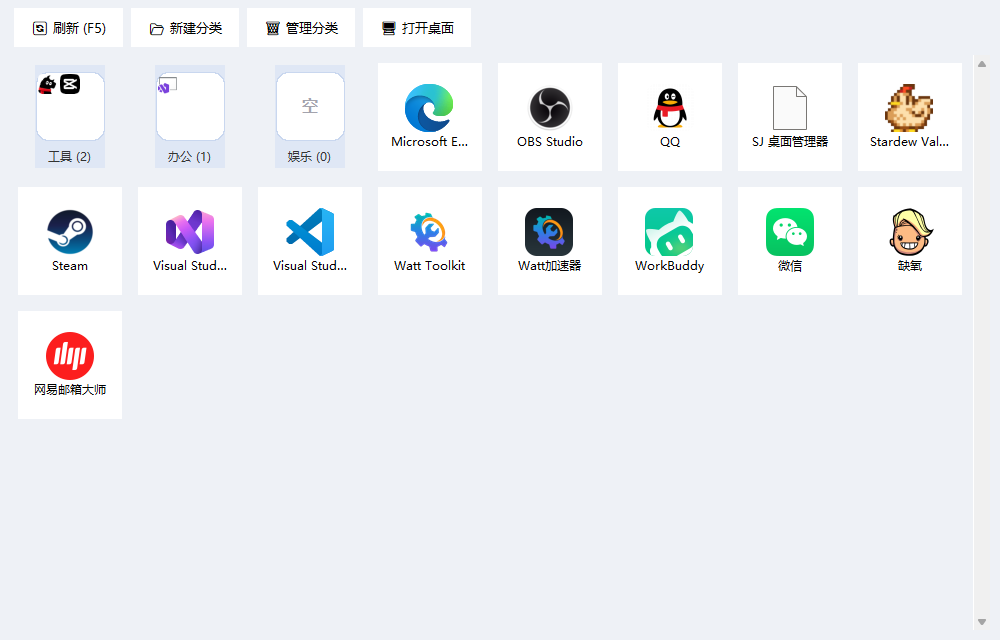
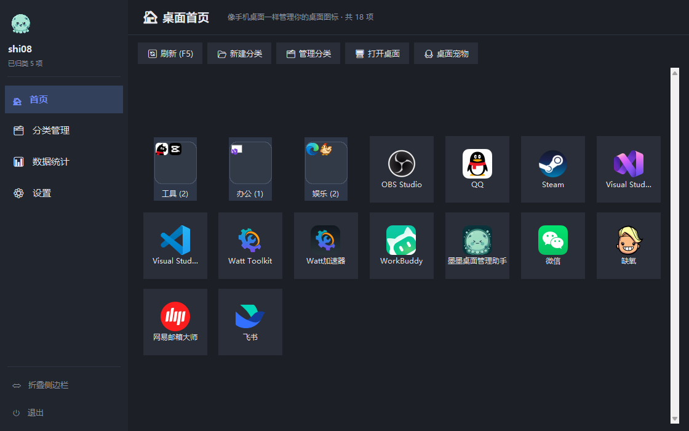
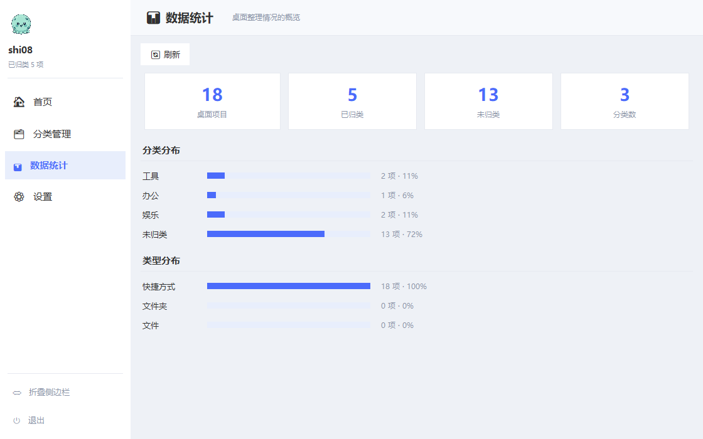
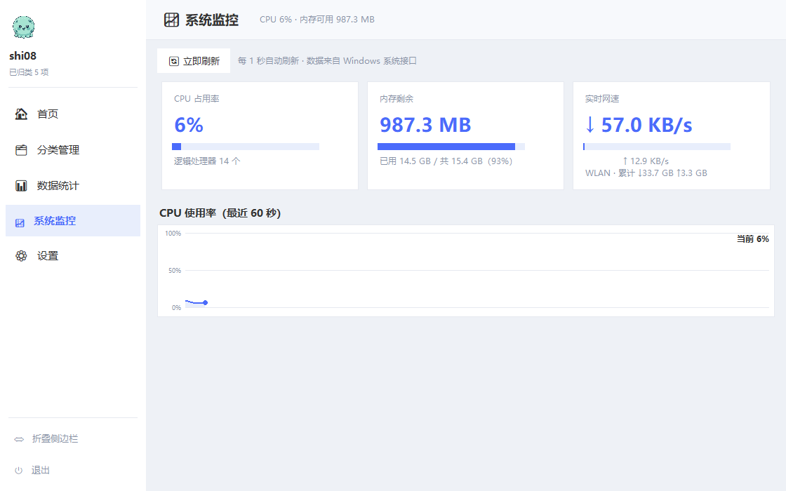
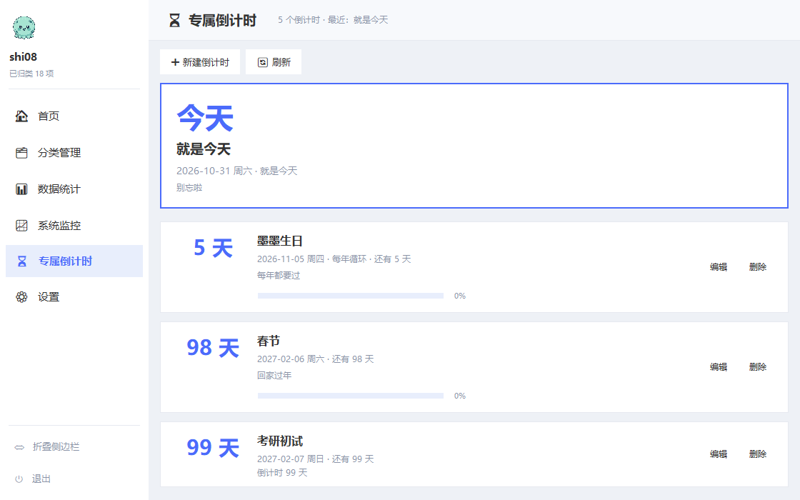

# 墨墨桌面管理助手（SJ-desktop-manager）

一款用 Python（tkinter）编写的 Windows 桌面管理器，把桌面变成"手机桌面"：
扫描桌面上的文件、文件夹和快捷方式，按你自定义的分类归入"文件夹"，清晰一目了然。

新版界面采用**左侧边栏导航 + 右侧主内容区**的布局。

| 浅色模式 · 首页 | 深色模式 · 首页 |
| --- | --- |
|  |  |







## 界面结构

**左侧边栏**

- 顶部用户信息：墨墨头像 + 当前 Windows 用户名 + 已归类数量
- 全局搜索框：输入即过滤桌面项与分类，回车打开第一项
- 导航菜单：首页 · 分类管理 · 数据统计 · 系统监控 · 专属倒计时 · 设置
  （左侧统一线性图标，当前页高亮）
- 左下角功能键：折叠 / 展开侧边栏（状态自动记住）、退出

**右侧主内容区**：点击左侧菜单切换对应的页面

| 页面 | 内容 |
| --- | --- |
| 🏠 首页 | 手机桌面式网格：真实图标磁贴、分类文件夹 3×3 预览、右键归类、Ctrl/Shift 多选批量移入 |
| 🗂 分类管理 | 分类卡片：图标预览、内容概览、打开 / 重命名 / 删除、新建分类 |
| 📊 数据统计 | 概览数字卡片 + 分类分布占比条 + 类型分布（快捷方式 / 文件夹 / 文件） |
| 📈 系统监控 | 每秒刷新：CPU 占用率（含 60 秒折线图）、内存剩余、实时下载 / 上传网速 |
| ⏳ 专属倒计时 | 倒数日：自定义目标日期，置顶大卡提醒最近的日子，支持每年循环、编辑 / 删除 |
| ⚙ 设置 | 浅色 / 深色主题、桌面宠物召唤、侧边栏折叠、版本信息 |

## 功能

- 🔄 自动扫描桌面（含公共桌面）上的文件 / 文件夹 / `.lnk` / `.url` 快捷方式
- 🧭 **左侧边栏导航**：用户信息 + 六个页面切换 + 底部折叠 / 退出，可一键折叠成纯图标；
  图标为**自制统一线性图标**（`gui/navicons.py`，24×24 网格、统一线宽圆头，
  纯 Canvas 绘制、颜色跟随主题，浅色 / 深色自动适配）
- 🔍 **全局搜索**：侧边栏顶部搜索框，输入即过滤首页的桌面项与分类（不重新扫描桌面，
  边打字边出结果），回车直接打开第一个匹配项，Esc 清空
- ⌨️ **全局热键**：设置页自定义（如 Ctrl+Alt+M），**一键呼出 / 隐藏主窗口**，
  窗口隐藏时也有效；默认组合被其它程序占用时自动降级到备用组合并提示，
  注册用 `RegisterHotKey` + 只按 `WM_HOTKEY` 过滤取消息（不影响 Tk 自身事件）
- 📐 **自适应网格**：每行磁贴数随窗口宽度自动增减（最小 4、最大 16），
  放大窗口后内容始终居中，排满一行后后续行顶到最左侧
- 🖼 **显示每个项目的系统真实图标**（而非统一的文件 emoji）——通过 Windows Shell 的
  `IShellItemImageFactory` 接口提取 48×48 带 alpha 通道的真彩图标，能正确解析
  Steam / UWP 类快捷方式的目标程序图标；提取失败时回退 `SHGetFileInfoW`，再回退 emoji
- 📁 **手机文件夹式分类磁贴**：分类磁贴内部按 3×3 预览该分类前 9 个项目的真实小图标，
  不打开文件夹就能看清里面放了什么；空分类显示提示，悬停高亮，圆角面板样式
- 🖱 双击即打开对应文件或程序；右键可将任意项目移入 / 移出分类
- 💾 分类与分配关系保存在 `config.json`，不会移动或改动桌面上的真实文件
- ⌨️ F5 刷新
- ⚙ **设置**：「⚙ 设置」页可切换**浅色 / 深色模式**，全界面（主窗口、侧边栏、
  磁贴、弹窗、右键菜单、统计页）统一换色，选择持久化到 `config.json`
- 🗂 **分类管理页**：以卡片形式管理全部分类（新建 / 重命名 / 删除 / 打开），
  首页工具栏与磁贴右键也能完成同样的操作
- 📊 **数据统计页**：桌面项目总数、已归类 / 未归类、分类数，以及分类与类型的分布条
- 🖱 右侧滚动条可点击轨道跳页、按住滑块拖动；内容不满一屏时自动置为不可滚状态
- 📈 **系统监控**：CPU 占用率（`GetSystemTimes` 两次采样求差）、物理内存剩余
  （`GlobalMemoryStatusEx`）、实时下载 / 上传网速（`GetIfTable2` 网卡计数差分，
  自动选中主力网卡、跳过过滤层避免重复计数），每秒自动刷新，
  含最近 60 秒 CPU 折线图，同样零第三方依赖
- ⏳ **专属倒计时（倒数日）**：自定义任意重要的日子（考试 / 生日 / 假期…），
  页面置顶大卡自动提醒最近的一个，列表按临近程度排序，支持「每年循环」的
  生日 / 纪念日、完成度进度条、编辑 / 删除；数据保存在 `config.json`，
  页面每分钟自动刷新，跨零点也会正确更新
- 🐙 **桌面宠物 2.0（物理引擎 + 深度联动）**：召唤墨墨到桌面独立悬浮，
  - **物理引擎**：抓住它随意甩，松手会把速度继承下来——重力下落、撞墙反弹、
    落地 Q 弹压缩动画（冲击越大压得越扁）
  - **摸头互动**：单击开心眯眼笑，3 秒内连点 5 次会害羞（腮红）
  - **系统状态联动**（可开关）：CPU ≥ 80% 好热冒汗吐舌、内存负载 ≥ 85% 累到
    半闭眼、下载 ≥ 400 KB/s 脚底抹油横向飞奔——状态变化时头顶冒气泡说明
  - **番茄钟伴学**：倒计时页 / 设置页 / 桌宠右键菜单均可开始；时长完全自定义
    （滚轮选专注分钟数 + 休息分钟数，可记住为默认），墨墨捧着书陪你专注，
    头顶显示倒计时；结束后（或被手动取消）**立刻收起倒计时**，只留一句庆祝
    提示，之后恢复正常状态
  - 头顶气泡、右键菜单（番茄钟 / 物理开关 / 联动开关 / 穿透 / 浮动速度），
    7 种表情立绘全部由 `tools/momo_states.py` 从原图程序化生成，零第三方依赖
- 🧹 自动过滤 `desktop.ini` 等隐藏 / 系统文件，不会混进网格

整个程序**只依赖 Python 标准库**（tkinter + ctypes 调用 Win32/COM），
包括图标提取和 PNG 编码都是纯标准库实现，无任何第三方依赖。

## 运行

双击 `run.bat`（**自动探测**本机的 Python，用 `pythonw.exe` 启动，不会弹出
命令行黑框），或：

```bash
python main.py
```

要求 Windows 10+ 与 Python 3.8+。首次运行会在项目根目录生成 `config.json`。

`run.bat` 的探测顺序：`MOMO_PYTHON` / `PYTHONW` 环境变量 → `py -3` 启动器 →
PATH 里的 `pythonw.exe` / `python.exe` → 常见安装目录
（`%LOCALAPPDATA%\Programs\Python`、`C:\Python3x`、`D:\Python3x`）→
仓库自带的 `runtime\pythonw.exe`。都不中时给出安装 / 用 exe 的提示。

### 打包成 exe（给没有 Python 的电脑）

```bash
pip install pyinstaller          # 仅是构建期工具，运行时依然零第三方依赖
python tools/build_exe.py        # 产物：dist\墨墨桌面管理助手.exe
python tools/build_exe.py --dir  # 或打包成目录（启动更快）
```

这个 exe 单文件、免安装，拷到任何一台 Windows 电脑双击即可运行
（不需要装 Python，图标与 `assets/` 已一并打进去）。

## 数据安全

`config.json` 存着你所有的分类、归类关系和倒计时，写入方式做了三重保险：

- **原子写入**：先写 `config.json.tmp` 并 `fsync`，再用 `os.replace` 整体替换，
  断电 / 崩溃不会留下半截文件
- **自动备份**：每次成功写入前，把上一份好配置留成 `config.json.bak`
- **损坏可恢复**：主文件读不出来时自动回退 `.bak`，并把损坏原件改名成
  `config.json.corrupt-<时间戳>` 留给你检查；只有在备份也损坏时才回默认配置，
  而且会明确提示，不会静默清零

## 专属图标与快捷方式

当前应用图标 `assets/momo.ico` 来自吉祥物「墨墨」（墨绿色小章鱼，见 `assets/mascot.png`），
由 `tools/mascot_to_ico.py` 生成（自动裁边去水印、四角圆角透明，内嵌 256/64/48/32/16
五个尺寸，纯 Python 标准库实现）。另保留备选图标 `assets/app-grid.ico`
（`tools/make_icon.py` 合成的蓝色圆角底 + 3×3 真实应用图标样式）。

`tools/make_shortcut.py` 可以一键在桌面创建指向本程序的快捷方式并应用图标
（通过 ctypes 直接调用 `IShellLinkW` + `IPersistFile` COM 接口，同样零依赖），
旧名快捷方式会被自动重命名：

```bash
python tools/mascot_to_ico.py   # 从吉祥物图生成 assets/momo.ico
python tools/make_icon.py       # 重新生成备选图标 assets/app-grid.ico
python tools/make_shortcut.py   # 在桌面创建/更新快捷方式
```

## 项目结构

```
SJ-desktop-manager/
├── main.py                # 启动入口（先声明 DPI 感知，再建窗口）
├── run.bat                # 一键启动（自动探测 Python，pythonw 无黑框）
├── core/
│   ├── scanner.py         # 桌面项扫描（过滤隐藏/系统文件，同名不同路径都保留）
│   ├── config.py          # 分类 / 倒计时 / 设置持久化（原子写 + 备份 + 可恢复）
│   ├── countdown.py       # 倒数日计算（日期解析、每年循环、剩余天数）
│   ├── icons.py           # 系统图标提取（Shell COM + 纯标准库 PNG 编码 + LRU 缓存）
│   ├── sysinfo.py         # 系统监控采集（CPU/内存/网速，ctypes 直调 Win32）
│   ├── hotkey.py          # 全局热键（RegisterHotKey + WM_HOTKEY 过滤轮询）
│   ├── dpi.py             # 高 DPI 感知声明
│   └── undo.py            # 多步撤销栈（纯逻辑，不依赖 tkinter）
├── gui/
│   ├── app.py             # 主框架：侧边栏 + 页面路由（页面实例缓存）
│   ├── pages.py           # 六个页面：首页 / 分类 / 统计 / 监控 / 倒计时 / 设置
│   ├── widgets.py         # 通用控件（胶囊渐变按钮、圆角搜索框、图标缩放…）
│   ├── navicons.py        # 自制统一线性图标（24×24 Canvas 矢量绘制）
│   ├── theme.py           # 浅色 / 深色主题配色表
│   ├── fonts.py           # 字体常量 + 缺失回退（无微软雅黑时自动降级）
│   ├── tokens.py          # 设计令牌：间距 / 字号 / 控件尺寸统一标尺
│   ├── category_ops.py    # 分类 新建/重命名/删除 的公共层（三处共用）
│   └── pet.py             # 桌面悬浮宠物（物理引擎 / 系统联动 / 番茄钟）
├── tools/
│   ├── build_exe.py       # PyInstaller 一键打包成 exe
│   ├── make_icon.py       # 合成备选 .ico 图标
│   ├── mascot_to_ico.py   # 吉祥物图 -> 应用 .ico
│   └── make_shortcut.py   # 创建/更新桌面快捷方式
├── tests/
│   ├── test_core.py       # core 层单测（倒计时 / 配置 / 撤销栈 / 图标缓存 key）
│   ├── test_gui.py        # gui 层单测（字体解析 / 胶囊按钮）
│   └── test_design.py     # 设计令牌守护（间距 / 字号不许再写散值）
├── assets/                # 图标、吉祥物图与截图
└── config.json            # 首次运行自动生成（已在 .gitignore 中）
```

## 测试

```bash
python -m unittest discover -s tests -v
```

覆盖：

* `core.countdown`（日期解析、闰年循环 2/29→2/28、进度区间）
* `core.config`（原子写 / 备份 / 损坏恢复 / 路径 key 迁移 / 失效清理 / 批量归类）
* `core.undo`（批量操作不被单项覆盖、深度封顶、按分类归并还原）
* `core.icons`（缓存 key 的斜杠 / 大小写变体归一）
* `gui.fonts` 与胶囊按钮（无 tkinter 的环境自动跳过）

## 许可

MIT，见 [LICENSE](LICENSE)。

## 更新日志

### v1.9 — 侧栏加宽 + 文字永不遮挡

- **侧边栏面积增大**：展开宽度 210 → 240、折叠宽度 64 → 72，宽度 / 行高 /
  缩进统一收进 `gui/tokens.py`（`SIDEBAR_W` / `SIDEBAR_W_MINI` /
  `TEXT_PAD`），以后调栏宽只动一处
- **软件名称完整露出**：侧栏顶部升级为品牌区——墨墨头像 + 「墨墨桌面
  管理助手」全名 + 版本 / 当前用户 / 已归类数三行小字，名字按像素度量
  保证完整显示（以前侧栏只有头像和用户名，软件名压根没露出来）
- **文字不再被裁**：新增 `widgets.fit_text()`——按字体实际像素度量截断
  （超长加省略号），替代按字数的 `short_name()`（12 个汉字和 12 个 W 宽度
  差一倍多）；侧栏的软件名、用户名、导航项、底部键全部接入
- 修一个隐蔽的反馈环：Label 文字变短 → 自身变窄 → 拿变窄后的宽度再截 →
  越截越短（实测能把「首页」截成空字符串）。导航文字改 `expand=True` 占满
  剩余宽度 + `fit_label` 用「见过的最大宽度」当基准，反馈环被掐断
- 矮窗口不再裁掉导航项：行高压到 26px 下限还不够时继续按均分压紧，
  6 个导航项 + 底部键在 800×420 展开态下也全部可见
- 自动折叠阈值 780 → 800：保证展开侧栏时内容区至少还剩 560px（`MIN_W`）

### v1.8 — 按设计稿对齐 + 图表补全 + 按钮调大

- 侧栏按设计稿实测回调（240 → 210、头像 48 → 32）；导航 / 底部项图标
  缩进与栏宽配套
- CPU 折线图左侧刻度不再被裁：绘图区左移出 56px 给刻度文字，右侧补
  「当前 N%」边距；图表高度跟随容器
- 页面按钮整体调大：工具栏 40px 高 / 胶囊内边距 20，卡片内小按钮 28 → 34
  （560×420 下自动换行且全部可见）

### v1.7.1 — 侧栏 / 顶栏规格对齐主流

- 展开侧栏 208 → 240（208 是主流侧栏的下限）；头像 44 → 48，
  图标左缩进 / 与文字间距改 `NAV_PAD=(13, 11)` 跟随栏宽
- 导航项行高 36 → 44、图标 18 → 22；底部项行高 / 搜索框统一 38、
  图标 19——导航比底部高一档、图标大一档，层级感更清晰
- 顶栏 56 → 64，页面主标题 14 → 17 号（新增 `FS["title"]` 档）
- **矮窗口下导航自动压紧**：导航区改为吃掉剩余高度并绑自己的
  `<Configure>`，高度不够时行高从 44 逐步压到 26、间距同步收紧，
  保证 560×420 下 6 个导航项 + 底部「折叠/退出」全部可见——
  顺带修了一个老问题：以前底部键最后打包，矮窗口下会被挤成 2px
  直接消失（现在先给底部键分配空间，导航区才是可压缩的那一个）

### v1.7 — 长页面可滚动 + 设计令牌收敛

**P1 真实缺陷**

- **长页面能滚动了**：新增 `widgets.ScrolledFrame`（Canvas + 主题滚动条 +
  滚轮），设置 / 倒计时 / 分类 / 统计 / 监控 / 首页六页共用。以前只有首页
  自己有一套滚动，设置页在 560×420 下内容 762px 而可视区仅 339px——
  直接被切掉且滚不动；顺带补上了首页本来就没有的滚轮
- **恢复尺寸下限引用 `MIN_W/MIN_H`**：原先写死 900×560，和 v1.6 的
  560×420 自相矛盾（缩到 600×450 退出，下次启动被弹回 900×560）
- 空态文案改指向真实存在的「上方工具栏」按钮（分类页 / 倒计时页，
  原来让用户去找一个不存在的右上角 ➕ 按钮）
- 设置页「关于」版本号 v1.0 → v1.7（一直停在初始版本）

**P2 参数层收敛**

- **设计令牌 `gui/tokens.py`**：间距 18 个散值收敛成 6 档（`SP["xs".."xxl"]`）、
  字号 13 个散值收敛成 6 档（`FS["xs".."hero"]`，最低 10 号——原来还有
  `font(7)` 这种读不清的）；`tests/test_design.py` 用文件扫描锁住，
  页面代码里再写裸 `padx=3` / `font(9)` 会直接挂测试
- 进度条高度统一 `BAR_H=10`（原来统计/监控 10px、倒计时 8px 两套）
- **卡片按钮统一成胶囊按钮**：分类卡的「打开/重命名/删除」、倒计时卡的
  「编辑/删除」、倒计时/番茄钟弹窗的底部按钮，原来全是原生直角小按钮，
  和工具栏的渐变胶囊同框像两个 App；卡片里的按钮抗锯齿改往 `card_bg` 混色，
  不再有一圈错色描边
- **弹窗标题统一**：`widgets.dialog_header()`（14 号主标题 + 10 号副标题），
  倒计时 / 番茄钟 / 热键 / 管理分类四个弹窗原来是三套规格
- **分类窗口与首页共用同一条缩放曲线**（`tile_scale`）：原来各算各的
  （首页 0.75 次方上限 1.75x，分类窗口线性上限 1.4x），两个窗口同时开时
  分类卡片竟比首页磁贴还大；现在 1120px 主窗口下磁贴 119px / 卡片 105px
- 侧边栏导航项与底部项统一高度 36 / 图标 18（原来 38/19 vs 34/17 两套）
- 深色主题标题条提亮一档（原来与内容区背景完全同色，和浅色主题不对称）
- 文件夹磁贴的「空」字随磁贴缩放（原来写死 12 号）；监控页折线图随窗口
  拉高（上限 300px）并补上小节分隔线；桌宠尺寸按屏幕 DPI 缩放
  （100%~200% 封顶），150% 屏上不再显得比界面小一圈
- **测试 34 → 40**：新增设计令牌守护、缩放曲线单调性、档位倍数制

### v1.6 — 窗口可以缩到正常软件的大小

- 最小尺寸从 900×560 放开到 **560×420**：以前拖到一半就顶住，缩不大；
  小屏笔记本上「最小」和「最大化」几乎一样大
- 初始尺寸自适应屏幕：小屏上不再一启动就占满
- 窗口窄于 780px 时**自动收起侧边栏**（图标条），拉宽自动恢复；
  临时收起不写进配置，不覆盖用户手动折叠的选择
- 顶部工具栏 / 批量操作条按钮**自动换行**：窄窗口下不再把右侧按钮挤出可视区
- 磁贴缩小下限放宽到 0.72 倍，小窗口能同时看到更多项目
- 窗口窄于 700px 时标题条隐藏副标题，保住主标题
- 测试 34 用例保持全绿（新增小窗口冒烟：缩放 / 自动折叠 / 按钮可见 / 最小化）

### v1.5 — 界面随窗口自适应缩放

- **首页磁贴跟着窗口变大**：以前窗口拉大只会多排几列，磁贴永远 96px，
  放大后满屏小图标配大片留白。现在磁贴宽度按网格宽度的 0.75 次方增长
  （上限 1.75 倍），图标、文件夹 3×3 预览、文字字号一同比放大；
  倍率只跟宽度挂钩，拖动窗口时尺寸单调变大，不会出现「拉宽反而变小」
- 列数按磁贴尺寸动态计算，多余宽度由 grid 均分进磁贴间距（不再挤在右边留白）
- **分类窗口随主窗口走**：打开的宽度/高度按主窗口比例（0.72 / 0.78，带上下限），
  内部卡片列数、尺寸也随窗口宽度自适应
- **统计页占比条、监控页进度条**改为横向填满可用宽度，不再钉死 260 / 210px
- **窗口大小与位置记忆**：退出时写进配置，下次启动原样恢复
  （换显示器导致坐标跑出屏幕时自动夹回屏内）
- 设置页新增「首页磁贴尺寸」档位：随窗口自适应（默认）/ 小 / 标准 / 大
- 测试 30 → 34（新增磁贴缩放曲线的单调性 / 不溢出 / 档位用例）

### v1.4 — 修掉新代码引入的缺陷 + 抽公共层（v1.4）

**P1 新代码引入的真实缺陷**

- **桌宠不再"静默死亡"**：`_tick` / `_monitor_tick` 的 `self.after(...)`
  原来排在 `try` 块内，而只捕 `tk.TclError`。`_sample()` 里 `pomo["minutes"]`
  是裸索引，一旦缺键（或任何非 `TclError` 异常）下一帧就不会再被排队 ——
  桌宠当场定格且控制台一声不吭。现在调度移到 `try` 之外，异常打印堆栈后
  动画继续跑；番茄钟字段全部改用 `.get()` 兜底
- **撤销不再被单项操作吃掉**：`_last_op` 单个快照改成 `core/undo.py` 的多步
  撤销栈（深度 10）。「批量移一批 → 右键再动一项 → 撤销」现在能连续回退，
  批量记录不会被覆盖；操作条在没有选中项但还有可撤销步骤时也保持可见，
  否则批量整理完就找不到撤销按钮了
- **选中计数不再虚高**：右键单项移入 / 移出后会把该项移出选中集
- **搜索 + Shift 连选不会选到看不见的项**：区间改成在「当前过滤后可见」
  的项里计算，不再用未过滤的全量列表

**P2 遗留与打磨**

- **"不再静默"补齐最后一环**：`load_status`（recovered / reset）此前只有
  数据层记录、`app.py` 没人读它。现在首次启动会明确弹一次提示，说明
  配置是从备份恢复的还是被重置的、原件留在哪儿
- **页面缓存下的刷新**：`refresh_pomodoro_ui()` 与设置页的番茄钟 / 宠物 /
  热键操作改成 `force=True` 重建，按钮文案不再停留在旧状态
  （页面缓存后不带 force 只是把旧实例重新 pack 出来）
- **分类 CRUD 抽公共层**：新建 / 重命名 / 删除三份复制粘贴收敛到
  `gui/category_ops.py`，三处调用方（首页工具栏、分类管理器弹窗、分类页）
  共用同一套判空与提示
- **字体常量**：`"Microsoft YaHei"` 曾硬编码 95 次，现在统一走
  `gui/fonts.py` 的 `font(size, ...)`，并在系统字体表里按优先级挑选，
  没有微软雅黑时自动降级（PingFang / Noto Sans CJK / 文泉驿 / SimHei…），
  不会再因为缺字体把中文显示成方块
- **搜索 / 重排不再白扫桌面**：`refresh()` 触发点显式传 `rescan=False`
  （搜索过滤、窗口换列、归类增删改都不需要重扫）
- **桌宠小项**：`set_speed` 不再改模块级全局（改实例属性）；疲惫状态只压低
  幅度，不会把用户选的「静止」档强行改活；奔跑速度复用 1.2 秒一次的系统
  采样，不再 60fps 每帧调 `net_speed()`；右键菜单不再写死 `entryconfig(0)`
- **清扫死代码**：`scanner.seen_here`（`scandir` 单目录不会返回重名）移除；
  `icons` 缓存 key 改用 `normcase`（与配置层 `item_key` 一致），
  斜杠 / 反斜杠写法不再产生重复缓存条目
- **测试**：新增 `core/undo`、`core.icons` 缓存 key 用例，以及
  `tests/test_gui.py`（字体解析、胶囊按钮不含独立 oval 图元）；
  共 30 个用例，无 tkinter 的环境自动跳过 GUI 部分

### v1.3 — 数据安全与工程化（原子写 / 备份 / 分发 / 归类鲁棒性）

**P0 数据安全**

- **原子写入**：`config.json` 改成「写 `config.json.tmp` → `fsync` → `os.replace`
  整体替换」，断电 / 崩溃不会留下半截文件（详见上方「数据安全」一节）
- **自动备份 + 可恢复**：每次成功写入前把上一份留成 `config.json.bak`；
  主文件读不出来时自动回退备份，损坏原件改名为 `config.json.corrupt-<时间戳>`
  保留待查；只有备份也坏才回默认配置，并明确提示，**不再静默清零**
- **分发门槛**：`run.bat` 不再硬编码 `D:\Python313`，改成自动探测
  （环境变量 → `py -3` → PATH → 常见安装目录 → 仓库自带 runtime），
  找不到时给出安装 / 用 exe 的指引；新增 `tools/build_exe.py` 一键
  PyInstaller 打包出单文件 exe（13.6 MB，免安装、无需 Python）

**P1 日常体验**

- **归类按路径而非文件名**：`assignments` 的 key 换成规范化绝对路径，
  文件改名 / 移动后归类不再失效；旧配置（文件名 key）在下次扫描时自动迁移，
  用户无感；顺带清掉指向已删除文件的死条目
- **不再被同名遮挡**：用户桌面与公共桌面的同名项目现在都会列出
  （原来按文件名全局去重，后者被前者顶掉，整理时会漏项）
- **切页不再重建**：页面实例缓存 + `pack_forget`，侧边栏只重画导航高亮。
  于是切页不再重扫桌面、不再重建搜索框（输入焦点不丢），
  系统监控页切走时停掉采样定时器、切回来再启动
- **高 DPI 感知**：启动前声明 Per-Monitor DPI Awareness（`core/dpi.py`），
  高缩放屏下图标和渐变按钮不再发虚

**P2 打磨**

- **批量整理**：首页支持 `Ctrl`/`Shift` + 点击多选，选中后工具栏下方出现
  「移入分类 / 移出分类 / 撤销上一步 / 取消选择」；分类窗口里移出某项后
  **不再直接关窗**，可以连续整理
- **桌宠**：物理步进改用真实经过时间（掉帧不再变慢动作，且夹了单帧上限），
  右键菜单选的浮动节奏会写进 `config.json`，下次召唤还是这个速度
- **图标**：缓存加上限（LRU，400 条）不再只增不减；首页磁贴图标改为
  **分批懒加载**（先显示 emoji 占位，再每帧补几个），桌面项很多时首屏不卡
- **开源卫生**：补上 `LICENSE`（MIT，此前 README 声明 MIT 却没有文件）；
  新增 `tests/test_core.py` 覆盖 `core.countdown` 与 `core.config`
  共 19 个用例：`python -m unittest discover -s tests -v`

### v1.2 — 界面现代化：统一图标 / 全局搜索 / 卡片动效 / 全局热键

- **统一线性图标**（`gui/navicons.py`）：侧边栏、工具栏、搜索框的图标全部换成
  自制描边式线性图标（24×24 网格、统一 1.7 线宽、圆头圆角），取代原先混用的
  emoji；颜色跟随主题与选中态，深浅色都清晰。坚持零第三方依赖，因此用纯
  Canvas 矢量绘制代替下载 SVG 图标包
- **全局搜索**：侧边栏「首页」上方新增搜索框（圆角胶囊 + 放大镜 + 一键清除），
  输入即过滤首页磁贴（名称 / 分类名），顶部标题条显示结果数，回车打开第一个
  匹配项；搜索时复用已扫描的桌面项，不卡顿
- **首页卡片动效**：磁贴悬停时**微微放大 + 淡淡的投影 + 底色高亮**（磁贴放进
  固定尺寸槽位居中，放大不推挤邻居，反复悬停也不抖动）
- **胶囊渐变按钮**（`ModernButton`）：圆角胶囊 + 垂直线性渐变 + 悬停高亮 +
  内置线性图标，主操作用强调色渐变；首页 / 各页面工具栏、分类管理器、设置页
  的按钮统一换新
- **全局热键（隐藏大招）**：设置 →「全局热键」可启用 / 自定义组合键
  （按下组合键即可录入），如 Ctrl+Alt+M **一键呼出 / 隐藏主界面**；
  默认组合冲突时自动改用备用组合并在设置页说明；`core/hotkey.py` 用
  `RegisterHotKey` 实现，轮询只取 `WM_HOTKEY` 消息，不影响 Tk 事件循环

### v1.1 — 番茄钟时长自定义

- **番茄钟时长完全自定义**：
  - 倒计时页「🍅 开始番茄钟」弹出时长框：**专注 / 休息两个滚轮**（1~600 分钟），
    附 15 / 25 / 45 / 60 / 90 分钟常用预设，可勾选「记住为默认时长」
  - 设置页直接内嵌专注 / 休息分钟数滚轮，改完点「开始番茄钟」即按该时长运行，
    并自动记为下次默认值
  - 桌宠右键菜单：菜单项实时显示当前默认时长（如「🍅 开始番茄钟（25 分钟）」），
    另有「⏱ 自定义番茄钟时长…」随时改
  - 时长持久化在 `config.json`（`pomodoro_minutes` / `pomodoro_break`）
- **结束后不再显示倒计时**：番茄钟到点或被手动结束时，墨墨头顶的倒计时气泡
  立即收起——到点会先播 8 秒「🍅 X 分钟专注完成！休息 Y 分钟吧～」庆祝，
  然后回到日常状态（系统联动 / 待机），不会再出现「还剩 00:00」
- 倒计时页新增「⏹ 结束番茄钟」按钮，可随时中止本轮专注

### v1.0 — 桌宠 2.0：物理引擎 + 系统联动 + 番茄钟

- **物理引擎**：拖拽时记录手部速度，松手继承 vx / vy —— 重力下落
  （G = 2200 px/s²）、左右墙壁反弹、地面反弹衰减（恢复系数 0.42），
  落地播放 Q 弹压缩动画（整数比缩放帧：压缩 → 回弹 → 拉伸 → 恢复，
  冲击越大压得越扁、弹得越久）；可在右键菜单关闭物理
- **互动升级**：单击开心，3 秒内连点 5 次触发害羞（腮红 + 眯眼）；
  新增头顶气泡（Canvas 圆角 + 小尾巴，跟随宠物移动）
- **系统状态联动**（复用 `core/sysinfo`，零依赖）：
  - CPU 占用 ≥ 80% → 「好热」立绘（汗滴 + 吐舌 + 脸红）
  - 内存负载 ≥ 85% → 「疲惫」立绘（半闭眼 + 黑眼圈），浮动也变得有气无力
  - 下载 ≥ 400 KB/s → 「奔跑」立绘（速度线），并在桌面上横向跑动，
    跑速随网速加快
  - 设置页可开关（`pet_monitor` 持久化）
- **番茄钟伴学**：倒计时页「🍅 番茄钟 45 分钟」/ 设置页 / 桌宠右键菜单均可
  开始；墨墨切「捧书学习」立绘，头顶实时显示剩余时间；到点弹窗提醒休息，
  桌宠气泡庆祝
- 新增 `tools/momo_states.py`：从原图程序化生成 5 张状态立绘
  （害羞 / 好热 / 疲惫 / 学习 / 奔跑），全部纯标准库像素绘制
- 修复：压缩动画时长单位混用（秒/毫秒）导致落地后僵住一分钟的问题

### v0.9 — 专属倒计时

- **新增「⏳ 专属倒计时」页面**（左侧边栏新栏目），一个简单的倒数日：
  - 点「➕ 新建倒计时」填写标题、**年 / 月 / 日三个滚轮直接选日期**（天数
    上限随年月自动变化，2 月自动 28 / 29 天；附「今天」一键回填，下方实时
    预览星期与剩余天数）、备注，可勾选**每年循环**（生日 / 纪念日）
  - 页面顶部**置顶大卡**自动展示最近的一个日子，起提醒作用
  - 每张卡片（含置顶大卡）都带**编辑 / 删除**按钮，也可以**右键卡片**直接操作；
    删除前有确认提示
  - 列表按临近程度排序（今天 → 更远 → 已过），每张卡片显示大号天数、
    目标日期 + 星期、备注与完成度进度条，可随时编辑 / 删除
- 新增 `core/countdown.py`（纯标准库 datetime）：多种日期格式解析、
  每年循环的下一次日期、剩余天数、完成度，2 月 29 日的循环自动落到 2 月 28 日
- 数据存 `config.json`（`countdowns` 列表），重启不丢；页面每分钟自动刷新，
  跨零点天数自动更新
- 空状态有引导提示；日期填错会提示修正

### v0.8.1 — 网速修复

- **修复网速一栏始终为 0 的问题**：旧接口 `GetIfTable`（32 位计数）在现代
  Windows 上经常对 Wi-Fi / 以太网返回全 0（驱动不再维护那份老统计），
  改用 64 位的 **`GetIfTable2`** 读取
- 通过在网卡缓冲区中搜索已知流量值定位 `MIB_IF_ROW2` 的真实布局：
  `sizeof = 1352`（SDK 惯用写法算出 1336 会导致步长错位），`InOctets` 偏移
  1208 / `OutOctets` 偏移 1280
- **不再重复计数**：跳过 WFP / QoS / LightWeight Filter 等「过滤层」接口
  （它们与物理网卡统计同一份流量），改为自动选中流量最大的主力网卡，
  网速卡片会显示网卡名（如 `WLAN · 累计 ↓33.7 GB ↑3.3 GB`）
- 拔网线 / 切换 Wi-Fi 导致主力网卡变化时自动重建采样基准，避免假峰值

### v0.8 — 系统监控

- **新增「📈 系统监控」页面**（左侧边栏新栏目），每 1 秒自动刷新：
  - **CPU 占用率**：大数字 + 进度条 + 最近 60 秒使用率折线图（Canvas 自绘）
  - **内存剩余**：可用内存大字显示，附已用 / 总量与负载百分比
  - **实时网速**：下载 / 上传速率 + 开机以来累计收发流量
- 新增 `core/sysinfo.py`：全部用 ctypes 直调 Win32（`GetSystemTimes`、
  `GlobalMemoryStatusEx`、`GetIfTable2`），依旧**零第三方依赖**
- 细节处理：排除回环 / 隧道接口、页面销毁时自动停止刷新定时器、
  首次采样先建基准避免首帧跳变

### v0.7 — 侧边栏布局改版

- **全新布局**：左侧边栏（用户信息 + 导航菜单 + 底部折叠 / 退出）+ 右侧主内容区，
  点击菜单切换页面，告别单页工具栏
- **四个页面**：🏠 首页（桌面网格）、🗂 分类管理（分类卡片，可新建 / 重命名 / 删除）、
  📊 数据统计（概览数字 + 分类与类型分布条）、⚙ 设置（主题 / 桌宠 / 侧边栏 / 关于）
- **侧边栏可折叠**：折叠后仅显示图标（宽 64px），状态写入 `config.json` 自动记住
- **自适应网格修复**：网格宽度跟随窗口，每行磁贴数按宽度自动增减；
  窗口放大后内容保持居中，排满一行后后续行顶到最左侧（不再逐行居中）
- **右侧滚动条**：加宽到 14px、跟随主题配色、鼠标悬停加深，可点击轨道跳页 / 拖动滑块；
  内容不满一屏时自动置为不可滚状态
- 代码拆分：新增 `gui/pages.py`（页面）与 `gui/widgets.py`（通用控件），
  `gui/app.py` 专注主框架与路由

### v0.6 — 设置与主题

- **新增设置栏目**（工具栏「⚙ 设置」）：可切换**浅色 / 深色模式**，
  选择保存在 `config.json`，下次启动自动记住
- 全界面统一换色：主窗口、磁贴、文件夹预览面板、右键菜单、
  分类管理器、分类内容窗、设置窗口本身
- 主题色集中在 `gui/theme.py`，新增配色只需在两套主题字典加同名 key

### v0.5 — 墨墨 2.0

- **新形象**：桌宠换上全新睁眼笑立绘（`tools/momo_faces.py` 去背景去水印）
- **点击互动**：点一下墨墨会眯眼笑一下再变回睁眼
  （眯眼形态由程序把眼球像素替换为"⌣"弧线自动生成，零第三方依赖）
- **交互提速**：眯眼时长 0.9s → 0.35s，右键菜单可调眨眼节奏
- **只留悬浮形态**：移除主窗口内的墨墨立绘与语录气泡，桌宠只保留桌面悬浮
- **管理分类重写**：改为真正的分类管理器——列表显示每个分类的项目数，
  支持新建 / 重命名 / 删除，重命名会同步已归属的项目
- **窗口居中**：分类管理器、分类内容窗相对主窗口居中打开（补偿 Tk 边框偏移）

### v0.4 — 桌面悬浮宠物

- **桌面悬浮宠物**（新增 `gui/pet.py`）：工具栏「🐙 桌面宠物」可召唤墨墨到桌面独立悬浮，
  无边框 + 背景完全透明（`-transparentcolor`），透明区域自动鼠标穿透不挡点击，
  并用 `after()` + 正弦曲线做上下浮动动画
- **消除透明边缘紫边**：自写 PNG 解码取真实 alpha（Tk 只给布尔），
  经去边（defringe）+ Bayer 抖动二值化，边缘干净无 halo
- **完全穿透模式**：右键菜单可切 `WS_EX_TRANSPARENT`，连章鱼本体也不挡点击
- 宠物尺寸 100px，参数集中在 `gui/pet.py` 顶部（尺寸 / 幅度 / 周期 / 帧率）

### v0.3 — 品牌焕新

- **应用图标**：墨绿色小章鱼吉祥物「墨墨」成为官方图标（多尺寸 `.ico`，
  自动去水印、圆角透明处理）
- **更名**：软件正式定名「墨墨桌面管理助手」

### v0.2 — 界面与体验优化

- **真实图标**：所有磁贴显示系统真实图标（`IShellItemImageFactory` 优先，
  `SHGetFileInfoW` 兜底），彻底告别"全靠 emoji 分辨"
- **文件夹预览磁贴**：分类磁贴内 3×3 预览分类内容的小图标，还原手机桌面文件夹体验
- **一键启动**：新增 `run.bat`，`pythonw` 启动全程无命令行黑框
- **专属应用图标**：纯 Python 合成多尺寸 `.ico`，并附一键创建桌面快捷方式的工具
- **修复**：分类窗口右键"移出分类"崩溃（缺失方法）；图标红蓝通道反色；
  隐藏/系统文件混入网格；长文件名截断改用省略号

### v0.1 — 初始版本

- 桌面扫描、分类管理、双击打开、F5 刷新

## Roadmap

- [ ] 拖拽分配项目到分类
- [x] 提取快捷方式真实图标
- [x] 多页面（侧边栏切换首页 / 分类 / 统计 / 设置）
- [x] 倒数日提醒（专属倒计时）
- [ ] 倒计时到期桌面通知
- [ ] 开机自启动
- [ ] 单实例锁（重复启动让第二个实例直接聚焦已有窗口，而不是热键降级）
- [x] 记住窗口位置与大小
- [ ] 系统托盘图标（热键隐藏后仍有常驻入口）
- [ ] 排序选项（文件夹优先 / 按类型 / 按时间，现在只有按名称）
- [ ] 按扩展名自动归类规则（如 `*.lnk` 自动进「工具」）
- [x] GitHub Actions 跑 `unittest`（`.github/workflows/tests.yml`）

## License

MIT
