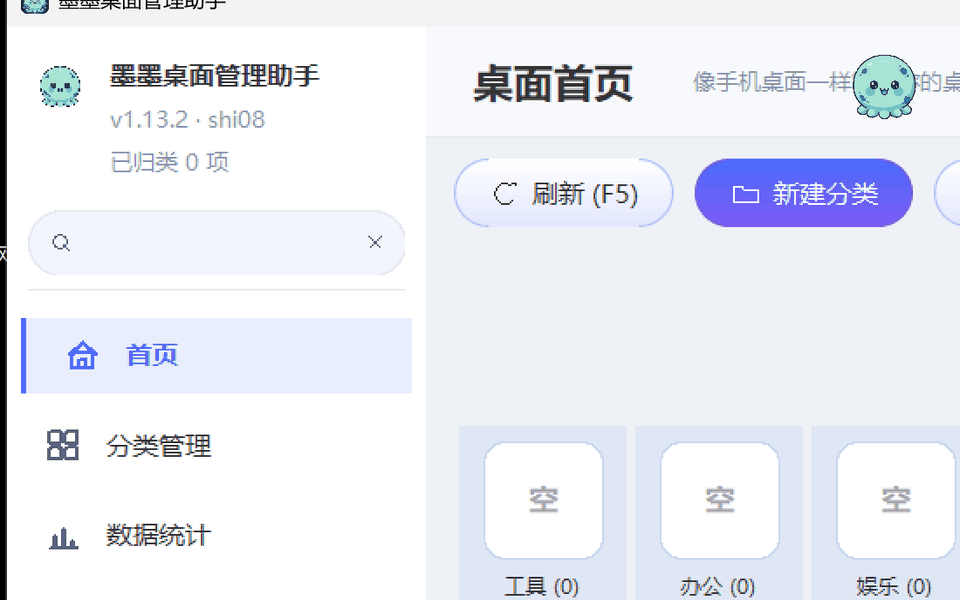
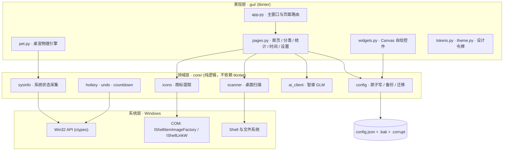

<a id="zh" name="zh"></a>

<div align="center">

# 墨墨桌面管理助手 · MoMo Desktop Manager

**把杂乱的 Windows 桌面，变成一块干净、可归类、有温度的磁贴屏。**
*Turn a cluttered Windows desktop into a clean, categorized, slightly alive tile board.*

[](https://www.python.org/downloads/)
[](LICENSE)
[](#)
[](#技术架构与工程亮点)
[](#)
[](#测试与持续集成)
[](https://github.com/shi-jin0825/SJ-desktop-manager/actions/workflows/tests.yml)
[](#项目结构)

[中文](#zh) · [English](#english)

</div>

---

## 目录

- [项目简介](#项目简介)
- [功能演示](#功能演示)
- [核心功能](#核心功能)
- [技术架构与工程亮点](#技术架构与工程亮点)
- [快速开始](#快速开始)
- [项目结构](#项目结构)
- [测试与持续集成](#测试与持续集成)
- [常见问题](#常见问题)
- [Roadmap](#roadmap)
- [License](#license)
- [English](#english)

---

## 项目简介

Windows 桌面的整理方式，二十年来几乎没有变化：图标只能靠手动拖动、按名称排序，或者干脆堆在屏幕边缘任由它变成"文件垃圾场"。市面上的美化工具大多以替换桌面为目标，一旦卸载便留下一地残留；而真正能"归类但不移动文件"的方案又寥寥无几。

**墨墨桌面管理助手**换了一个思路：它不接管你的桌面，而是把桌面上的文件、文件夹与快捷方式**映射**成一块类似手机桌面的磁贴屏——真实图标、自适应网格、可分类收纳、可全局搜索，底层文件一个都不搬动。

更具辨识度的是，它以 **零第三方运行时依赖** 为技术底线：图形界面用 `tkinter`，系统图标提取、CPU / 内存 / 网速采集、全局热键、快捷方式创建全部通过 `ctypes` 直调 Win32 与 COM 接口实现，连 PNG 编码都是用 `zlib + struct` 手写的。项目迭代至 **v1.13.2，累计 31 个版本，约 10,300 行 Python**，并配有 **62 项自动化测试** 与跨平台 CI。

> 一句话概括：**一个把"少装一个库"当成架构约束，而不是当成偷懒理由的桌面工具。**

---

## 功能演示



*磁贴桌面 → 全局搜索 → 分类 → 时间管理 → 统计 → 呼出桌宠 → 番茄钟伴学（全流程演示）*

### 界面截图

| 磁贴桌面（浅色） | 磁贴桌面（深色） |
| :---: | :---: |
|  |  |
| **时间管理：计划 / 倒计时 / 番茄钟** | **数据统计** |
|  |  |

---

## 核心功能

| 模块 | 能力 |
| :--- | :--- |
| **桌面管理** | 自动扫描桌面（含公共桌面）的文件、文件夹、`.lnk` 与 `.url`，过滤隐藏 / 系统项；磁贴每行 4–16 列随窗口宽度自适应；文件夹磁贴内部以 3×3 预览前 9 项图标 |
| **分类体系** | 手机文件夹式分类，右键移入 / 移出；分类只是"映射关系"，**不移动、不重命名、不删除**任何真实文件，卸载即还原 |
| **全局交互** | 侧边栏实时搜索（输入即过滤、回车打开首项）；可自定义全局热键（默认 `Ctrl+Alt+M`）在窗口隐藏时一键呼出；浅色 / 深色主题全界面统一换色并持久化 |
| **桌面宠物「墨墨」** | 独立悬浮窗口，具备抓取甩出、重力下落、撞墙反弹、落地 Q 弹压缩的物理表现；单击摸头开心、连点害羞；CPU 高时冒汗、内存不足时疲惫、网速快时奔跑，并以头顶气泡提示 |
| **时间管理** | 日程计划（可选日期 / 不限日期，按逾期 → 今天 → 未来 → 无日期排序，支持拖拽）、倒数日（每年循环 + 完成度进度条）、番茄钟（重启恢复、离线补签、秒级暂停、多轮休息阶段、声音 + 任务栏闪烁 + 隐藏自动唤起） |
| **AI 助手** | 设置页内嵌对话窗口，接入智谱 `glm-4-flash`；子线程请求、主线程回调；断网、无 Key、限流时全部友好兜底，**不崩溃** |
| **数据统计与管理** | 桌面项目总数、归类覆盖率、类型分布，以及专注轮数、累计时长、计划完成率；配置支持导出 / 导入（校验 + 自动备份）/ 清理 |

---

## 技术架构与工程亮点

### 架构总览



分层原则：**`core/` 不允许 `import tkinter`**。领域逻辑因此可以在无显示环境下被单元测试直接覆盖，GUI 只负责渲染与事件绑定。

### 六个值得关注的工程决策

**1. 零第三方运行时依赖：把约束当成设计语言**

`requirements.txt` 全文只有一行注释。不是"没来得及引入库"，而是主动的取舍：

- **收益**：`git clone` 后 `python main.py` 即可运行；PyInstaller 产物无需捆绑 NumPy / Pillow 等大型轮子，单文件 exe 体积可控；无供应链风险与版本冲突；在离线机器、受限企业环境中可直接部署。
- **代价**：图标解码、PNG 编码、物理动画等能力必须自行实现，开发成本显著高于"装个库"。
- **边界**：PyInstaller 仅作为**构建期**工具，不进入运行时依赖树。

**2. `ctypes` 直调 Win32 / COM，而非封装库**

| 能力 | 实现路径 | 关键细节 |
| :--- | :--- | :--- |
| 真实系统图标 | Shell COM `IShellItemImageFactory::GetImage` → 回退 `SHGetFileInfoW` + `DrawIconEx` → 回退 emoji | 提取 48×48 带 alpha 的真彩位图，能正确解析 Steam / UWP 快捷方式的**目标程序**图标，而非通用箭头 |
| PNG 编码 | `zlib` + `struct` 手写 chunk | 将 HBITMAP 的 BGRA 像素转换为 RGBA 并编码，供 tkinter 直接显示 |
| CPU 占用 | `GetSystemTimes` 两次采样求差 | `kernel` 时间**已包含** `idle`，故占用率为 `(Δkernel + Δuser − Δidle) / (Δkernel + Δuser)`——少减一次 idle 就会得到恒定偏高的错误读数 |
| 网速 | `iphlpapi.GetIfTable2` 64 位计数器差分 | 主动弃用 32 位 `MIB_IFROW`，规避现代 Windows 上的计数器回绕 |
| 全局热键 | `RegisterHotKey` + `WM_HOTKEY` 消息过滤 | 与 Tk 事件循环共存，不劫持主线程消息泵 |
| 快捷方式 | `IShellLinkW` + `IPersistFile` | 零依赖生成带自定义图标的 `.lnk` |

**3. Canvas 逐像素自绘 UI + 设计令牌收敛**

胶囊渐变按钮、圆角输入框、圆角勾选框、线性图标全部由 `Canvas` 绘制，而非原生控件——因为 `ttk` 的可定制上限无法满足视觉稿。

随之而来的问题是数值失控：整理前，**间距在 177 处使用了 18 个不同取值、字号在 93 处使用了 13 个取值**，进度条高度并存 8px / 10px 两套。`gui/tokens.py` 将这一切收敛为两把标尺——页面只声明"语义"（区块间距 / 控件间距 / 标题字号），具体像素由令牌统一裁决。配合 Per-Monitor DPI 感知与等比缩放，界面在 100%–200% 缩放下均保持清晰。

**4. 配置持久化的三层数据保险**

`core/config.py` 的写入路径为：**临时文件 → `flush` + `fsync` → `os.replace` 原子替换**，并在替换前保留上一份健康配置为 `.bak`；读取时若主文件损坏，自动回退 `.bak`，同时把损坏文件隔离为 `config.json.corrupt-<timestamp>` 而不是静默删除。

这解决的是桌面工具最容易被忽视的事故：**在写入途中断电或强杀进程，用户的分类与倒计时会整体归零**。`os.replace` 在 Windows 上同样是原子语义，这一点常被误认为只有 POSIX 才具备。

**5. 「拒绝静默失效」的失败设计**

- **AI 调用**：`core/ai_client.py` 对 401（Key 无效）、429（限流 / 额度耗尽）、5xx、`URLError`、超时逐类映射为可读文案，任何异常都不向上抛出。UI 侧以子线程发请求、主线程回调刷新，输入框在等待期间保持可用。
- **图标提取**：三级回退（COM → Win32 → emoji），保证任何一项都有视觉表示。
- **配置校验**：字段缺失走迁移补全，非法值回落默认，写盘失败给出明确提示而非吞掉异常。
- **撤销**：`core/undo.py` 用**多步撤销栈**替代早期的单变量 `_last_op`。旧实现中"批量移动一批 → 右键再动一项 → 撤销"只会回退最后一步，批量记录凭空消失；改为栈后每一步均可回退，并设深度上限防止无限堆积。

**6. 可测试性是被架构保证的**

`core/` 的纯逻辑（配置原子写、扫描健壮性、AI 客户端错误分支、倒计时计算、撤销栈）全部可在无 GUI 环境下测试；`tests/` 另有 GUI 冒烟测试，在无显示环境下自动跳过而非失败。CI 覆盖 **Windows + Ubuntu × Python 3.10 / 3.11 / 3.12 / 3.13** 共 8 个组合。

### 主张与证据对照

下表把每条关键主张映射到可验证的代码位置，方便按图索骥：

| 主张 | 可验证证据 |
| :--- | :--- |
| 运行时零依赖 | `requirements.txt` 仅含注释；全仓库无第三方 `import` |
| 原子写与损坏恢复 | `core/config.py` → `save()` / `_save_atomic()` / `_load()` / `_quarantine()` |
| 系统图标提取 | `core/icons.py` → COM 优先、Win32 回退、纯标准库 PNG 编码 |
| 系统状态采集 | `core/sysinfo.py` → CPU 差分公式、`GlobalMemoryStatusEx`、`GetIfTable2` |
| 设计规范落地 | `gui/tokens.py` 全量令牌；页面中无裸像素常量 |
| 桌宠物理表现 | `gui/pet.py` 抓取 / 重力 / 反弹 / 落地压缩状态机 |
| 多步撤销 | `core/undo.py` → `UndoStack`，含栈深上限 |
| 测试与 CI | `tests/` 5 个测试文件，62 项用例；`.github/workflows/tests.yml` 矩阵构建 |

---

## 快速开始

### 环境要求

| 项目 | 要求 |
| :--- | :--- |
| 操作系统 | Windows 10 / 11（图标提取、热键、系统采集依赖 Win32；其他平台可启动但功能降级） |
| Python | 3.10+（CI 覆盖至 3.13） |
| tkinter | 随 python.org 官方安装包提供；安装时需勾选 **tcl/tk and IDLE** |
| 第三方库 | **无** |

### 1. 获取代码

```bash
git clone https://github.com/shi-jin0825/SJ-desktop-manager.git
cd SJ-desktop-manager
```

### 2. 安装依赖

本项目无第三方运行时依赖，**无需 `pip install`**。仅需确认 `tkinter` 可用：

```bash
python -c "import tkinter; print('tkinter OK', tkinter.TkVersion)"
```

若报 `ModuleNotFoundError: No module named 'tkinter'`，说明安装 Python 时未勾选 tcl/tk 组件，请重新运行官方安装包并勾选该组件（conda 用户可执行 `conda install tk`）。

`requirements.txt` 保留用于声明"零依赖"这一契约，执行 `pip install -r requirements.txt` 不会安装任何包。

### 3. 配置智谱 API Key

AI 助手能力依赖智谱开放平台的免费模型 `glm-4-flash`。Key 通过环境变量 `ZHIPU_API_KEY` 注入，**源码中不含任何密钥**。

**第一步：获取 Key**

访问 [智谱开放平台](https://open.bigmodel.cn/) → 注册 / 登录 → 右上角「API Keys」→ 创建并复制密钥。

**第二步：写入环境变量**（任选一种）

PowerShell，仅当前窗口有效：

```powershell
$env:ZHIPU_API_KEY = "your_api_key_here"
```

PowerShell / CMD，永久写入当前用户（**推荐**，需新开终端生效）：

```powershell
setx ZHIPU_API_KEY "your_api_key_here"
```

CMD，仅当前窗口有效：

```cmd
set ZHIPU_API_KEY=your_api_key_here
```

**第三步：验证**

```powershell
# PowerShell
$env:ZHIPU_API_KEY

# CMD
echo %ZHIPU_API_KEY%
```

> **注意**：`setx` 只影响此后新启动的进程。若程序已在运行，请关闭并重新启动，或在设置页重开 AI 对话窗口。
>
> **为何不支持 `.env` 文件**：读取 `.env` 需要引入 `python-dotenv`，与"零第三方依赖"的约束冲突。系统环境变量同样是业界标准的密钥注入方式，且在打包后的 exe 中行为一致。未配置 Key 时，除 AI 对话外的所有功能均可正常使用。

### 4. 运行

```bash
python main.py
```

或直接双击项目根目录的 `run.bat`——它会按「`MOMO_PYTHON` → `py -3` → PATH → 常见安装目录 → 便携运行时」的顺序自动探测可用的 Python，无需手动配置路径。

启动后：

- 首次运行会自动扫描桌面并生成磁贴，`config.json` 在首次保存时创建；
- 默认全局热键 `Ctrl+Alt+M` 呼出 / 隐藏窗口，可在「设置 → 全局热键」中修改；
- 右键磁贴可移入分类，侧边栏顶部搜索框支持即时过滤。

### 5. 运行测试

```bash
python -m unittest discover -s tests -v
```

预期输出 `Ran 62 tests ... OK`。GUI 冒烟测试在无显示环境下会自动跳过（`skipped`），不影响结果。

### 6. 打包为单文件 exe

```bash
python tools/build_exe.py
```

产物位于 `dist/墨墨桌面管理助手.exe`，可在未安装 Python 的 Windows 机器上直接运行。构建依赖 PyInstaller，但**产物运行时不依赖任何第三方库**。

---

## 项目结构

```text
SJ-desktop-manager/
├── main.py                  # 入口：DPI 感知 → 启动 App
├── run.bat                  # 免配置启动器（自动探测 Python）
├── requirements.txt         # 声明零第三方依赖
│
├── core/                    # 领域层：纯逻辑，禁止 import tkinter
│   ├── config.py            #   配置原子写 / 备份 / 损坏隔离 / 迁移
│   ├── scanner.py           #   桌面扫描（含公共桌面、隐藏项过滤）
│   ├── icons.py             #   系统图标提取 + 纯标准库 PNG 编码
│   ├── sysinfo.py           #   CPU / 内存 / 网速采集
│   ├── ai_client.py         #   智谱 GLM 客户端（含全错误分支兜底）
│   ├── hotkey.py            #   全局热键注册与消息过滤
│   ├── countdown.py         #   倒数日 / 番茄钟时间计算
│   ├── undo.py              #   多步撤销栈
│   └── dpi.py               #   Per-Monitor DPI 感知
│
├── gui/                     # 表现层：tkinter
│   ├── app.py               #   主窗口、侧边栏、页面路由、全局搜索
│   ├── pages.py             #   首页 / 分类 / 统计 / 时间管理 / 设置
│   ├── widgets.py           #   Canvas 自绘控件（胶囊按钮 / 圆角框 / 勾选框）
│   ├── pet.py               #   桌宠「墨墨」物理引擎与状态联动
│   ├── theme.py             #   浅色 / 深色主题
│   ├── tokens.py            #   设计令牌（间距 / 字号 / 控件尺寸）
│   ├── fonts.py             #   字体与 DPI 缩放
│   ├── navicons.py          #   侧边栏线性图标
│   └── category_ops.py      #   分类交互编排
│
├── tests/                   # 62 项自动化测试
│   ├── test_core.py         #   配置 / 扫描 / 倒计时 / 撤销
│   ├── test_ai_client.py    #   AI 客户端错误分支（含 Mock 网络）
│   ├── test_gui.py          #   GUI 冒烟
│   ├── test_pages_smoke.py  #   页面实例化冒烟
│   └── test_design.py       #   设计令牌一致性
│
├── tools/                   # 构建与素材生成脚本（不进入运行时）
│   ├── build_exe.py         #   PyInstaller 单文件打包
│   ├── make_icon.py         #   .ico 生成
│   ├── make_shortcut.py     #   .lnk 生成
│   ├── momo_faces.py        #   7 种表情程序化绘制
│   └── mascot_cutout.py     #   立绘抠图
│
├── assets/                  # 界面截图、图标、桌宠立绘
└── .github/workflows/       # CI：2 OS × 4 Python 版本
```

---

## 测试与持续集成

```text
Ran 62 tests in 0.46s
OK (skipped=12)
```

- **覆盖范围**：`core/` 纯逻辑（配置原子写、损坏恢复、扫描健壮性、倒计时与番茄钟状态机、撤销栈）、`ai_client` 的全部错误分支（401 / 429 / 5xx / 超时 / 无 Key，均以 Mock 注入）、GUI 与页面实例化冒烟、设计令牌一致性。
- **CI 矩阵**：`ubuntu-latest` + `windows-latest` × Python `3.10 / 3.11 / 3.12 / 3.13`，共 8 个组合，任一失败即红。
- **跳过策略**：无显示环境下的 GUI 用例自动 `skip` 而非 `fail`，避免 CI 噪声掩盖真实回归。

```bash
# 全量测试
python -m unittest discover -s tests -v

# 仅核心逻辑
python -m unittest tests.test_core -v
```

---

## 常见问题

<details>
<summary><b>启动时报 <code>No module named 'tkinter'</code></b></summary>

Python 安装时未包含 tcl/tk 组件。Windows 请重新运行 [python.org](https://www.python.org/downloads/) 安装包并勾选 **tcl/tk and IDLE**；conda 环境执行 `conda install tk`。
</details>

<details>
<summary><b>AI 对话提示「还没拿到 API Key」</b></summary>

环境变量未生效。确认变量名为 `ZHIPU_API_KEY`（全大写），并使用 `setx` 写入后**新开终端**；程序启动后才设置的变量对当前进程不可见，需重启程序。
</details>

<details>
<summary><b>AI 提示「Key 好像不对」或「额度用完了」</b></summary>

分别对应 HTTP 401 与 429。前者请检查 Key 是否复制完整、是否已在智谱平台启用；后者为免费额度耗尽或瞬时限流，稍后重试即可。这两类错误均不会导致程序崩溃。
</details>

<details>
<summary><b>磁贴里出现通用箭头图标</b></summary>

说明该快捷方式的目标已失效（程序被卸载或路径变更），三级图标回退机制退到了默认图标。删除该快捷方式即可。
</details>

<details>
<summary><b>能否在 macOS / Linux 上运行？</b></summary>

可以启动，但系统图标提取、全局热键、CPU / 内存 / 网速采集均为 Win32 实现，会降级为 emoji 图标并关闭对应功能。本项目定位是 Windows 桌面工具。
</details>

<details>
<summary><b>分类操作会移动或删除我的桌面文件吗？</b></summary>

不会。分类仅记录"路径 → 分类名"的映射关系，存于 `config.json`；移出分类只是删除该映射。所有文件操作均不涉及移动、重命名或删除。
</details>

---

## Roadmap

- [ ] 桌面项多选与批量拖拽分类
- [ ] 分类自定义图标与排序
- [ ] 番茄钟与系统勿扰模式（Focus Assist）联动
- [ ] 可选的多 Provider 适配层（保持 OpenAI 兼容协议，默认仍为智谱）

---

## 更新日志

### v1.13.2 — 设置页「AI 助手」对话窗口

- 设置页新增「AI 助手」区块 +「打开对话」按钮，弹出独立对话窗口
- 新增 `AIChatDialog`：聊天气泡（左灰右蓝）+ 底部输入框 + 发送按钮，
  与主界面同一套配色 / 字体 / 圆角控件，风格统一
- 支持按回车发送、点击「发送」按钮发送；思考中显示「墨墨正在思考中…」，
  结果切回主线程后替换气泡展示
- 请求走 `App.ask_momo` 子线程，界面不卡死；断网 / 无 Key 友好兜底

### v1.13.1 — 接入智谱 GLM 大模型（AI 对话）

- 新增 `core/ai_client.py`：独立封装 `ask_ai(question, system_prompt)`，
  默认模型 `glm-4-flash`，网络请求与 UI 完全解耦
- `gui/app.py` 新增 `App.ask_momo(...)`：子线程发请求 + 主线程回调刷新，
  界面不卡死；`on_start`/`on_done` 两个回调控制「思考中…」与结果展示
- 全链路异常兜底：未配 Key / 断网 / Key 无效 / 余额不足均返回友好提示，
  不崩溃
- API Key 走环境变量 `ZHIPU_API_KEY`（见「AI 对话」章节）
- 新增 UI 集成示例 `tools/ai_demo.py` 与单测 `tests/test_ai_client.py`

### v1.13.0 — 番茄钟 2.0：持久化 / 暂停恢复 / 休息阶段 + 数据闭环

**番茄钟**

- **计时持久化**：状态落盘到 config.json，重启后恢复——退出不再丢一轮
  专注；退出期间到点的会自动**补记统计**并明确告知「补签」
- **暂停 / 继续**：时间管理页工具栏、桌宠右键菜单均可暂停，剩余秒数
  精确保留；顶栏右侧新增常驻倒计时（🍅 专注 / ☕ 休息 / ⏸ 已暂停），
  不召唤桌宠也能在任何页面看到剩余时间，点一下直达时间管理页
- **休息阶段**：专注完成询问「开始休息」→ 休息倒计时（桌宠气泡同步
  ☕ 显示）→ 休息结束提醒并可一键进入**下一轮专注**，多轮循环打通
- **提醒可感知**：到点提醒 = 提示音（MessageBeep）+ 任务栏图标闪烁
  （FlashWindow）+ 窗口被热键隐藏时自动唤起，不再只靠一个可能看不见的
  模态弹窗

**桌宠与联动**

- **召唤状态持久化**：重启后墨墨自动回到桌面（退出程序不算主动收起）
- **联动不再整体静默失效**：`_measure` 三个指标各自独立容错——CPU
  采不到（首次无基准返回 None）不再拖垮内存 / 网速判断；全部采不到时
  气泡明确告知「系统状态采不到了」
- **气泡优先级仲裁**：番茄钟倒计时 > 庆祝 > 状态提示 / 互动，低优先级
  不再互相覆盖（以前 8 处写入打架，倒计时一闪一闪）

**数据统计与配置管理**

- 统计页新增「专注与计划」：番茄轮数、累计专注时长（X 小时 Y 分）、
  计划完成率进度条
- 设置页新增「数据管理」：**导出配置**（另存 JSON）、**导入配置**
  （格式校验 + 先备份后替换）、**清理配置**（恢复默认，自动备份 .bak）

**测试**：新增番茄钟持久化 / 统计累加 / 导入替换共 6 个用例，
全量 56 个用例通过 + 番茄钟全流程 GUI 冒烟（开始→暂停→恢复→重启
恢复→离线补签）

### v1.12.5 — 勾选框全项目统一放大

- **一个尺寸**：此前勾选框三套混用——原生 Checkbutton（高分屏上只有
  ~13px，看不清）、自绘 20px（计划卡片）、自绘 24px（不限定日期）。
  现在全部换成公共组件 `RoundedCheck`，尺寸统一收进 `tokens.CHECKBOX`
  （26px，高 DPI 等比放大），以后改大小只动一处
- **覆盖 6 处**：设置页「系统状态联动 / 启用全局热键」、倒数日弹窗
  「每年循环」、番茄钟弹窗「记住为默认时长」、计划弹窗「不限定日期」、
  计划卡片完成勾选框
- 整行（框 + 文字）都可点；顺带修了旧实现里「点文字不生效」的隐患
  （Tk 事件不冒泡到父控件，以前只绑了行容器）

### v1.12.4 — 评审修复：四个「静默失效」闭环 + 写盘失败兜底

**P1 真实缺陷**

- **滚轮不再全局劫持**：`bind_all("<MouseWheel>")` 原来把应用内「所有」控件的
  滚轮事件都转发给首页网格——在设置页下拉框、弹窗、对话框里滚动鼠标，
  背后的首页网格会跟着乱滚。现在先确认事件确实落在首页 canvas（或其后代）
  上才转发
- **扫描不再一崩全崩**：`scan_desktop()` 的 `os.scandir()` 原来裸调用，
  桌面被 OneDrive 接管 / 某个桌面目录暂时不可读时整个扫描抛异常，被 Tk
  回调吞掉，用户看到一个没有提示的空白首页。现在单个目录失败只跳过该
  目录，其余桌面照常列出
- **热键全灭不再静默**：候选组合全被其它程序占用时原来没有任何提示，
  现在设置页会明确显示「全局热键注册失败，请手动更换组合」
- **写盘失败有兜底**：`config.save()` 原来在盘满 / 只读目录（比如 exe 装进
  Program Files）会把 OSError 抛进 Tk 回调被吞掉——看着保存成功了其实
  没落盘。现在写盘失败会记录 `save_error` 并弹窗明确告知「本次修改只在
  内存中」，不再假装成功

**P2 顺手修**

- 桌宠物理：落地 Q 弹动画的基底从「永远 idle 脸」改为「当前脸」——
  番茄钟伴学时落地不会再把捧书脸切回默认笑脸闪一下
- 清理 `gui/pet.py` 里重复定义的 `_monitor_tick`（后定义覆盖前定义的死代码）

**测试**：新增扫描健壮性（单个目录不可读 / 全不可读）与写盘失败
（记录 + reporter 通知 + 内存数据不受影响）共 4 个用例，
全量 50 个用例通过

### v1.12.2 — 计划拖拽排序 + 输入字号加大

- **日程计划支持拖拽排序**：按住卡片（勾选框 / 按钮除外）上下拖动换位，
  拖动中卡片悬浮高亮；手动拖过一次后列表按手动顺序展示并存入
  `config.json`（`plans_manual_order`），不再被智能排序覆盖
- **输入框字号排查**：表单输入框 / 日期滚轮的字号从 11pt 提到 12pt——
  不是 bug，是西文字母的 x-height 只有中文字形的一半大，同字号下打英文
  视觉上小一圈；侧栏搜索框同理由 10pt 提到 11pt

### v1.12.1 — 「不限定日期」勾选框放大

- 从原生 Checkbutton 换成自绘圆角勾选框（24px，高 DPI 下等比放大），
  与计划卡片上的勾选框同款样式，勾选后蓝底白勾

### v1.12 — 「专属倒计时」升级「时间管理」，新增日程计划

- **导航改名**：侧边栏「专属倒计时」→「时间管理」（图标 🕐 → 📅 calendar，
  页面 key 保持 `countdowns` 不动，config 无需迁移）
- **新增日程计划**：自定义计划内容——标题 + 日期（年 / 月 / 日滚轮，实时显示
  星期与倒计时）+ 备注，或勾选「不限定日期」当随时可做的待办
- **卡片勾选框**：自绘圆角勾选框（原生 Checkbutton 主题适配太丑），点一下
  完成 / 重做——完成项划线置灰、自动记录完成日期（`done_at`），排序收进
  已完成区
- **排序规则**：逾期 → 今天 → 未来 → 无日期 → 已完成（纯逻辑在
  `core/countdown.py` 的 `plan_describe` / `plan_sort_key`）
- **存储**：`config.json` 新增 `plans` 字段，CRUD 在 `core/config.py`
  （与倒计时同一套原子写入 / 备份机制）
- 页面分「📋 日程计划」「⏳ 倒数日」两个区块，顶栏汇总待办数；
  新增 5 个单测（计划描述 / 排序 / CRUD），共 45 个

### v1.11 — 砍掉系统监控页，状态感知收归桌宠

- **侧边栏不再有「系统监控」入口**，`SystemPage` 整个页面删除（v1.10 起约 200
  行：三指标卡 + CPU 60 秒折线图）；页面从六个减为五个，其余页面不受影响
- **后台采样保留并转移给桌面宠物**：`core/sysinfo.py` 的采集接口不变，但不再是
  「监控页打开才采样」——召唤墨墨后由 `gui/pet.py` 的 `_monitor_tick` 每秒
  后台采样一次（间隔 1.2s → 1.0s）
- **状态直接由桌宠表达**（对应原来 `check_system_status` 的思路，之前就有、
  本次对齐阈值）：CPU > 80% → 冒汗吐舌脸 + 「好热呀」气泡；内存负载 > 90%
  （原 85%）→ 疲惫脸 + 吐槽；网速快 → 奔跑动画；正常则回到待机表情
- `pages.py` 不再引用 `sysinfo`；设置页里桌宠「系统联动」开关保留

### v1.10 — 高 DPI 适配（真机 exe 验证）

- **根因修复**：程序声明了 Per-Monitor DPI 感知后，Tk 会把字号按系统缩放
  自动放大（150% 屏上 11pt ≈ 22px），但侧栏 240、磁贴 96 这些**容器常量
  仍是 100% 缩放的像素值**——字大容器小，这就是用户真机上「软件名 / 磁贴
  名称被遮挡」反复出现的底层原因
- 新增 `tokens.px()` 与 `tokens.UI_SCALE`：启动时读取系统缩放，所有布局
  常量（侧栏宽、导航行高、磁贴 / 图标尺寸、图表边距、弹窗宽高、按钮高度）
  统一乘上缩放系数，字体与容器永远同比例
- 验证：150% 真机 exe 实测——品牌区全名完整、导航六项完整、磁贴长名
  省略号收尾无左右裁切；200% 下源码冒烟通过

### v1.9 — 侧栏加宽 + 文字永不遮挡

- **侧边栏面积增大**：展开宽度 210 → 240、折叠宽度 64 → 72，宽度 / 行高 /
  缩进统一收进 `gui/tokens.py`（`SIDEBAR_W` / `SIDEBAR_W_MINI` /
  `TEXT_PAD`），以后调栏宽只动一处
- **软件名称完整露出**：侧栏顶部升级为品牌区——墨墨头像 + 「墨墨桌面
  管理助手」全名 + 版本 / 当前用户 / 已归类数三行小字，名字按像素度量
  保证完整显示（以前侧栏只有头像和用户名，软件名压根没露出来）
- **文字不再被裁**：新增 `widgets.fit_text()`——按字体实际像素度量截断
  （超长加省略号），替代按字数的 `short_name()`（12 个汉字和 12 个 W 宽度
  差一倍多）；侧栏的软件名、用户名、导航项、底部键全部接入
- **磁贴名称不再被裁掉两头**（根因修复）：tk.Button 的 `width` 参数单位是
  「字符」，之前塞的是像素值——按钮的内容画布被撑到巨大，`place` 只露出
  中间一条，「Microsoft E…」就成了「icrosoft E」。现在磁贴按钮不再传
  width/height（显示尺寸由 place 的像素参数决定），名字改按磁贴实际像素
  宽截断（`DesktopPage._fit_tile_name`），磁贴多窄名字就跟到多窄；
  分类页磁贴 / 首页文件夹卡片同步修复
- 修一个隐蔽的反馈环：Label 文字变短 → 自身变窄 → 拿变窄后的宽度再截 →
  越截越短（实测能把「首页」截成空字符串）。导航文字改 `expand=True` 占满
  剩余宽度 + `fit_label` 用「见过的最大宽度」当基准，反馈环被掐断
- 矮窗口不再裁掉导航项：行高压到 26px 下限还不够时继续按均分压紧，
  6 个导航项 + 底部键在 800×420 展开态下也全部可见
- 自动折叠阈值 780 → 800：保证展开侧栏时内容区至少还剩 560px（`MIN_W`）

### v1.8 — 按设计稿对齐 + 图表补全 + 按钮调大

- 侧栏按设计稿实测回调（240 → 210、头像 48 → 32）；导航 / 底部项图标
  缩进与栏宽配套
- CPU 折线图左侧刻度不再被裁：绘图区左移出 56px 给刻度文字，右侧补
  「当前 N%」边距；图表高度跟随容器
- 页面按钮整体调大：工具栏 40px 高 / 胶囊内边距 20，卡片内小按钮 28 → 34
  （560×420 下自动换行且全部可见）

### v1.7.1 — 侧栏 / 顶栏规格对齐主流

- 展开侧栏 208 → 240（208 是主流侧栏的下限）；头像 44 → 48，
  图标左缩进 / 与文字间距改 `NAV_PAD=(13, 11)` 跟随栏宽
- 导航项行高 36 → 44、图标 18 → 22；底部项行高 / 搜索框统一 38、
  图标 19——导航比底部高一档、图标大一档，层级感更清晰
- 顶栏 56 → 64，页面主标题 14 → 17 号（新增 `FS["title"]` 档）
- **矮窗口下导航自动压紧**：导航区改为吃掉剩余高度并绑自己的
  `<Configure>`，高度不够时行高从 44 逐步压到 26、间距同步收紧，
  保证 560×420 下 6 个导航项 + 底部「折叠/退出」全部可见——
  顺带修了一个老问题：以前底部键最后打包，矮窗口下会被挤成 2px
  直接消失（现在先给底部键分配空间，导航区才是可压缩的那一个）

### v1.7 — 长页面可滚动 + 设计令牌收敛

**P1 真实缺陷**

- **长页面能滚动了**：新增 `widgets.ScrolledFrame`（Canvas + 主题滚动条 +
  滚轮），设置 / 倒计时 / 分类 / 统计 / 监控 / 首页六页共用。以前只有首页
  自己有一套滚动，设置页在 560×420 下内容 762px 而可视区仅 339px——
  直接被切掉且滚不动；顺带补上了首页本来就没有的滚轮
- **恢复尺寸下限引用 `MIN_W/MIN_H`**：原先写死 900×560，和 v1.6 的
  560×420 自相矛盾（缩到 600×450 退出，下次启动被弹回 900×560）
- 空态文案改指向真实存在的「上方工具栏」按钮（分类页 / 倒计时页，
  原来让用户去找一个不存在的右上角 ➕ 按钮）
- 设置页「关于」版本号 v1.0 → v1.7（一直停在初始版本）

**P2 参数层收敛**

- **设计令牌 `gui/tokens.py`**：间距 18 个散值收敛成 6 档（`SP["xs".."xxl"]`）、
  字号 13 个散值收敛成 6 档（`FS["xs".."hero"]`，最低 10 号——原来还有
  `font(7)` 这种读不清的）；`tests/test_design.py` 用文件扫描锁住，
  页面代码里再写裸 `padx=3` / `font(9)` 会直接挂测试
- 进度条高度统一 `BAR_H=10`（原来统计/监控 10px、倒计时 8px 两套）
- **卡片按钮统一成胶囊按钮**：分类卡的「打开/重命名/删除」、倒计时卡的
  「编辑/删除」、倒计时/番茄钟弹窗的底部按钮，原来全是原生直角小按钮，
  和工具栏的渐变胶囊同框像两个 App；卡片里的按钮抗锯齿改往 `card_bg` 混色，
  不再有一圈错色描边
- **弹窗标题统一**：`widgets.dialog_header()`（14 号主标题 + 10 号副标题），
  倒计时 / 番茄钟 / 热键 / 管理分类四个弹窗原来是三套规格
- **分类窗口与首页共用同一条缩放曲线**（`tile_scale`）：原来各算各的
  （首页 0.75 次方上限 1.75x，分类窗口线性上限 1.4x），两个窗口同时开时
  分类卡片竟比首页磁贴还大；现在 1120px 主窗口下磁贴 119px / 卡片 105px
- 侧边栏导航项与底部项统一高度 36 / 图标 18（原来 38/19 vs 34/17 两套）
- 深色主题标题条提亮一档（原来与内容区背景完全同色，和浅色主题不对称）
- 文件夹磁贴的「空」字随磁贴缩放（原来写死 12 号）；监控页折线图随窗口
  拉高（上限 300px）并补上小节分隔线；桌宠尺寸按屏幕 DPI 缩放
  （100%~200% 封顶），150% 屏上不再显得比界面小一圈
- **测试 34 → 40**：新增设计令牌守护、缩放曲线单调性、档位倍数制

### v1.6 — 窗口可以缩到正常软件的大小

- 最小尺寸从 900×560 放开到 **560×420**：以前拖到一半就顶住，缩不大；
  小屏笔记本上「最小」和「最大化」几乎一样大
- 初始尺寸自适应屏幕：小屏上不再一启动就占满
- 窗口窄于 780px 时**自动收起侧边栏**（图标条），拉宽自动恢复；
  临时收起不写进配置，不覆盖用户手动折叠的选择
- 顶部工具栏 / 批量操作条按钮**自动换行**：窄窗口下不再把右侧按钮挤出可视区
- 磁贴缩小下限放宽到 0.72 倍，小窗口能同时看到更多项目
- 窗口窄于 700px 时标题条隐藏副标题，保住主标题
- 测试 34 用例保持全绿（新增小窗口冒烟：缩放 / 自动折叠 / 按钮可见 / 最小化）

### v1.5 — 界面随窗口自适应缩放

- **首页磁贴跟着窗口变大**：以前窗口拉大只会多排几列，磁贴永远 96px，
  放大后满屏小图标配大片留白。现在磁贴宽度按网格宽度的 0.75 次方增长
  （上限 1.75 倍），图标、文件夹 3×3 预览、文字字号一同比放大；
  倍率只跟宽度挂钩，拖动窗口时尺寸单调变大，不会出现「拉宽反而变小」
- 列数按磁贴尺寸动态计算，多余宽度由 grid 均分进磁贴间距（不再挤在右边留白）
- **分类窗口随主窗口走**：打开的宽度/高度按主窗口比例（0.72 / 0.78，带上下限），
  内部卡片列数、尺寸也随窗口宽度自适应
- **统计页占比条、监控页进度条**改为横向填满可用宽度，不再钉死 260 / 210px
- **窗口大小与位置记忆**：退出时写进配置，下次启动原样恢复
  （换显示器导致坐标跑出屏幕时自动夹回屏内）
- 设置页新增「首页磁贴尺寸」档位：随窗口自适应（默认）/ 小 / 标准 / 大
- 测试 30 → 34（新增磁贴缩放曲线的单调性 / 不溢出 / 档位用例）

### v1.4 — 修掉新代码引入的缺陷 + 抽公共层（v1.4）

**P1 新代码引入的真实缺陷**

- **桌宠不再"静默死亡"**：`_tick` / `_monitor_tick` 的 `self.after(...)`
  原来排在 `try` 块内，而只捕 `tk.TclError`。`_sample()` 里 `pomo["minutes"]`
  是裸索引，一旦缺键（或任何非 `TclError` 异常）下一帧就不会再被排队 ——
  桌宠当场定格且控制台一声不吭。现在调度移到 `try` 之外，异常打印堆栈后
  动画继续跑；番茄钟字段全部改用 `.get()` 兜底
- **撤销不再被单项操作吃掉**：`_last_op` 单个快照改成 `core/undo.py` 的多步
  撤销栈（深度 10）。「批量移一批 → 右键再动一项 → 撤销」现在能连续回退，
  批量记录不会被覆盖；操作条在没有选中项但还有可撤销步骤时也保持可见，
  否则批量整理完就找不到撤销按钮了
- **选中计数不再虚高**：右键单项移入 / 移出后会把该项移出选中集
- **搜索 + Shift 连选不会选到看不见的项**：区间改成在「当前过滤后可见」
  的项里计算，不再用未过滤的全量列表

**P2 遗留与打磨**

- **"不再静默"补齐最后一环**：`load_status`（recovered / reset）此前只有
  数据层记录、`app.py` 没人读它。现在首次启动会明确弹一次提示，说明
  配置是从备份恢复的还是被重置的、原件留在哪儿
- **页面缓存下的刷新**：`refresh_pomodoro_ui()` 与设置页的番茄钟 / 宠物 /
  热键操作改成 `force=True` 重建，按钮文案不再停留在旧状态
  （页面缓存后不带 force 只是把旧实例重新 pack 出来）
- **分类 CRUD 抽公共层**：新建 / 重命名 / 删除三份复制粘贴收敛到
  `gui/category_ops.py`，三处调用方（首页工具栏、分类管理器弹窗、分类页）
  共用同一套判空与提示
- **字体常量**：`"Microsoft YaHei"` 曾硬编码 95 次，现在统一走
  `gui/fonts.py` 的 `font(size, ...)`，并在系统字体表里按优先级挑选，
  没有微软雅黑时自动降级（PingFang / Noto Sans CJK / 文泉驿 / SimHei…），
  不会再因为缺字体把中文显示成方块
- **搜索 / 重排不再白扫桌面**：`refresh()` 触发点显式传 `rescan=False`
  （搜索过滤、窗口换列、归类增删改都不需要重扫）
- **桌宠小项**：`set_speed` 不再改模块级全局（改实例属性）；疲惫状态只压低
  幅度，不会把用户选的「静止」档强行改活；奔跑速度复用 1.2 秒一次的系统
  采样，不再 60fps 每帧调 `net_speed()`；右键菜单不再写死 `entryconfig(0)`
- **清扫死代码**：`scanner.seen_here`（`scandir` 单目录不会返回重名）移除；
  `icons` 缓存 key 改用 `normcase`（与配置层 `item_key` 一致），
  斜杠 / 反斜杠写法不再产生重复缓存条目
- **测试**：新增 `core/undo`、`core.icons` 缓存 key 用例，以及
  `tests/test_gui.py`（字体解析、胶囊按钮不含独立 oval 图元）；
  共 30 个用例，无 tkinter 的环境自动跳过 GUI 部分

### v1.3 — 数据安全与工程化（原子写 / 备份 / 分发 / 归类鲁棒性）

**P0 数据安全**

- **原子写入**：`config.json` 改成「写 `config.json.tmp` → `fsync` → `os.replace`
  整体替换」，断电 / 崩溃不会留下半截文件（详见上方「数据安全」一节）
- **自动备份 + 可恢复**：每次成功写入前把上一份留成 `config.json.bak`；
  主文件读不出来时自动回退备份，损坏原件改名为 `config.json.corrupt-<时间戳>`
  保留待查；只有备份也坏才回默认配置，并明确提示，**不再静默清零**
- **分发门槛**：`run.bat` 不再硬编码 `D:\Python313`，改成自动探测
  （环境变量 → `py -3` → PATH → 常见安装目录 → 仓库自带 runtime），
  找不到时给出安装 / 用 exe 的指引；新增 `tools/build_exe.py` 一键
  PyInstaller 打包出单文件 exe（13.6 MB，免安装、无需 Python）

**P1 日常体验**

- **归类按路径而非文件名**：`assignments` 的 key 换成规范化绝对路径，
  文件改名 / 移动后归类不再失效；旧配置（文件名 key）在下次扫描时自动迁移，
  用户无感；顺带清掉指向已删除文件的死条目
- **不再被同名遮挡**：用户桌面与公共桌面的同名项目现在都会列出
  （原来按文件名全局去重，后者被前者顶掉，整理时会漏项）
- **切页不再重建**：页面实例缓存 + `pack_forget`，侧边栏只重画导航高亮。
  于是切页不再重扫桌面、不再重建搜索框（输入焦点不丢），
  系统监控页切走时停掉采样定时器、切回来再启动
- **高 DPI 感知**：启动前声明 Per-Monitor DPI Awareness（`core/dpi.py`），
  高缩放屏下图标和渐变按钮不再发虚

**P2 打磨**

- **批量整理**：首页支持 `Ctrl`/`Shift` + 点击多选，选中后工具栏下方出现
  「移入分类 / 移出分类 / 撤销上一步 / 取消选择」；分类窗口里移出某项后
  **不再直接关窗**，可以连续整理
- **桌宠**：物理步进改用真实经过时间（掉帧不再变慢动作，且夹了单帧上限），
  右键菜单选的浮动节奏会写进 `config.json`，下次召唤还是这个速度
- **图标**：缓存加上限（LRU，400 条）不再只增不减；首页磁贴图标改为
  **分批懒加载**（先显示 emoji 占位，再每帧补几个），桌面项很多时首屏不卡
- **开源卫生**：补上 `LICENSE`（MIT，此前 README 声明 MIT 却没有文件）；
  新增 `tests/test_core.py` 覆盖 `core.countdown` 与 `core.config`
  共 19 个用例：`python -m unittest discover -s tests -v`

### v1.2 — 界面现代化：统一图标 / 全局搜索 / 卡片动效 / 全局热键

- **统一线性图标**（`gui/navicons.py`）：侧边栏、工具栏、搜索框的图标全部换成
  自制描边式线性图标（24×24 网格、统一 1.7 线宽、圆头圆角），取代原先混用的
  emoji；颜色跟随主题与选中态，深浅色都清晰。坚持零第三方依赖，因此用纯
  Canvas 矢量绘制代替下载 SVG 图标包
- **全局搜索**：侧边栏「首页」上方新增搜索框（圆角胶囊 + 放大镜 + 一键清除），
  输入即过滤首页磁贴（名称 / 分类名），顶部标题条显示结果数，回车打开第一个
  匹配项；搜索时复用已扫描的桌面项，不卡顿
- **首页卡片动效**：磁贴悬停时**微微放大 + 淡淡的投影 + 底色高亮**（磁贴放进
  固定尺寸槽位居中，放大不推挤邻居，反复悬停也不抖动）
- **胶囊渐变按钮**（`ModernButton`）：圆角胶囊 + 垂直线性渐变 + 悬停高亮 +
  内置线性图标，主操作用强调色渐变；首页 / 各页面工具栏、分类管理器、设置页
  的按钮统一换新
- **全局热键（隐藏大招）**：设置 →「全局热键」可启用 / 自定义组合键
  （按下组合键即可录入），如 Ctrl+Alt+M **一键呼出 / 隐藏主界面**；
  默认组合冲突时自动改用备用组合并在设置页说明；`core/hotkey.py` 用
  `RegisterHotKey` 实现，轮询只取 `WM_HOTKEY` 消息，不影响 Tk 事件循环

### v1.1 — 番茄钟时长自定义

- **番茄钟时长完全自定义**：
  - 倒计时页「🍅 开始番茄钟」弹出时长框：**专注 / 休息两个滚轮**（1~600 分钟），
    附 15 / 25 / 45 / 60 / 90 分钟常用预设，可勾选「记住为默认时长」
  - 设置页直接内嵌专注 / 休息分钟数滚轮，改完点「开始番茄钟」即按该时长运行，
    并自动记为下次默认值
  - 桌宠右键菜单：菜单项实时显示当前默认时长（如「🍅 开始番茄钟（25 分钟）」），
    另有「⏱ 自定义番茄钟时长…」随时改
  - 时长持久化在 `config.json`（`pomodoro_minutes` / `pomodoro_break`）
- **结束后不再显示倒计时**：番茄钟到点或被手动结束时，墨墨头顶的倒计时气泡
  立即收起——到点会先播 8 秒「🍅 X 分钟专注完成！休息 Y 分钟吧～」庆祝，
  然后回到日常状态（系统联动 / 待机），不会再出现「还剩 00:00」
- 倒计时页新增「⏹ 结束番茄钟」按钮，可随时中止本轮专注

### v1.0 — 桌宠 2.0：物理引擎 + 系统联动 + 番茄钟

- **物理引擎**：拖拽时记录手部速度，松手继承 vx / vy —— 重力下落
  （G = 2200 px/s²）、左右墙壁反弹、地面反弹衰减（恢复系数 0.42），
  落地播放 Q 弹压缩动画（整数比缩放帧：压缩 → 回弹 → 拉伸 → 恢复，
  冲击越大压得越扁、弹得越久）；可在右键菜单关闭物理
- **互动升级**：单击开心，3 秒内连点 5 次触发害羞（腮红 + 眯眼）；
  新增头顶气泡（Canvas 圆角 + 小尾巴，跟随宠物移动）
- **系统状态联动**（复用 `core/sysinfo`，零依赖）：
  - CPU 占用 ≥ 80% → 「好热」立绘（汗滴 + 吐舌 + 脸红）
  - 内存负载 ≥ 85% → 「疲惫」立绘（半闭眼 + 黑眼圈），浮动也变得有气无力
  - 下载 ≥ 400 KB/s → 「奔跑」立绘（速度线），并在桌面上横向跑动，
    跑速随网速加快
  - 设置页可开关（`pet_monitor` 持久化）
- **番茄钟伴学**：倒计时页「🍅 番茄钟 45 分钟」/ 设置页 / 桌宠右键菜单均可
  开始；墨墨切「捧书学习」立绘，头顶实时显示剩余时间；到点弹窗提醒休息，
  桌宠气泡庆祝
- 新增 `tools/momo_states.py`：从原图程序化生成 5 张状态立绘
  （害羞 / 好热 / 疲惫 / 学习 / 奔跑），全部纯标准库像素绘制
- 修复：压缩动画时长单位混用（秒/毫秒）导致落地后僵住一分钟的问题

### v0.9 — 专属倒计时

- **新增「⏳ 专属倒计时」页面**（左侧边栏新栏目），一个简单的倒数日：
  - 点「➕ 新建倒计时」填写标题、**年 / 月 / 日三个滚轮直接选日期**（天数
    上限随年月自动变化，2 月自动 28 / 29 天；附「今天」一键回填，下方实时
    预览星期与剩余天数）、备注，可勾选**每年循环**（生日 / 纪念日）
  - 页面顶部**置顶大卡**自动展示最近的一个日子，起提醒作用
  - 每张卡片（含置顶大卡）都带**编辑 / 删除**按钮，也可以**右键卡片**直接操作；
    删除前有确认提示
  - 列表按临近程度排序（今天 → 更远 → 已过），每张卡片显示大号天数、
    目标日期 + 星期、备注与完成度进度条，可随时编辑 / 删除
- 新增 `core/countdown.py`（纯标准库 datetime）：多种日期格式解析、
  每年循环的下一次日期、剩余天数、完成度，2 月 29 日的循环自动落到 2 月 28 日
- 数据存 `config.json`（`countdowns` 列表），重启不丢；页面每分钟自动刷新，
  跨零点天数自动更新
- 空状态有引导提示；日期填错会提示修正

### v0.8.1 — 网速修复

- **修复网速一栏始终为 0 的问题**：旧接口 `GetIfTable`（32 位计数）在现代
  Windows 上经常对 Wi-Fi / 以太网返回全 0（驱动不再维护那份老统计），
  改用 64 位的 **`GetIfTable2`** 读取
- 通过在网卡缓冲区中搜索已知流量值定位 `MIB_IF_ROW2` 的真实布局：
  `sizeof = 1352`（SDK 惯用写法算出 1336 会导致步长错位），`InOctets` 偏移
  1208 / `OutOctets` 偏移 1280
- **不再重复计数**：跳过 WFP / QoS / LightWeight Filter 等「过滤层」接口
  （它们与物理网卡统计同一份流量），改为自动选中流量最大的主力网卡，
  网速卡片会显示网卡名（如 `WLAN · 累计 ↓33.7 GB ↑3.3 GB`）
- 拔网线 / 切换 Wi-Fi 导致主力网卡变化时自动重建采样基准，避免假峰值

### v0.8 — 系统监控

- **新增「📈 系统监控」页面**（左侧边栏新栏目），每 1 秒自动刷新：
  - **CPU 占用率**：大数字 + 进度条 + 最近 60 秒使用率折线图（Canvas 自绘）
  - **内存剩余**：可用内存大字显示，附已用 / 总量与负载百分比
  - **实时网速**：下载 / 上传速率 + 开机以来累计收发流量
- 新增 `core/sysinfo.py`：全部用 ctypes 直调 Win32（`GetSystemTimes`、
  `GlobalMemoryStatusEx`、`GetIfTable2`），依旧**零第三方依赖**
- 细节处理：排除回环 / 隧道接口、页面销毁时自动停止刷新定时器、
  首次采样先建基准避免首帧跳变

### v0.7 — 侧边栏布局改版

- **全新布局**：左侧边栏（用户信息 + 导航菜单 + 底部折叠 / 退出）+ 右侧主内容区，
  点击菜单切换页面，告别单页工具栏
- **四个页面**：🏠 首页（桌面网格）、🗂 分类管理（分类卡片，可新建 / 重命名 / 删除）、
  📊 数据统计（概览数字 + 分类与类型分布条）、⚙ 设置（主题 / 桌宠 / 侧边栏 / 关于）
- **侧边栏可折叠**：折叠后仅显示图标（宽 64px），状态写入 `config.json` 自动记住
- **自适应网格修复**：网格宽度跟随窗口，每行磁贴数按宽度自动增减；
  窗口放大后内容保持居中，排满一行后后续行顶到最左侧（不再逐行居中）
- **右侧滚动条**：加宽到 14px、跟随主题配色、鼠标悬停加深，可点击轨道跳页 / 拖动滑块；
  内容不满一屏时自动置为不可滚状态
- 代码拆分：新增 `gui/pages.py`（页面）与 `gui/widgets.py`（通用控件），
  `gui/app.py` 专注主框架与路由

### v0.6 — 设置与主题

- **新增设置栏目**（工具栏「⚙ 设置」）：可切换**浅色 / 深色模式**，
  选择保存在 `config.json`，下次启动自动记住
- 全界面统一换色：主窗口、磁贴、文件夹预览面板、右键菜单、
  分类管理器、分类内容窗、设置窗口本身
- 主题色集中在 `gui/theme.py`，新增配色只需在两套主题字典加同名 key

### v0.5 — 墨墨 2.0

- **新形象**：桌宠换上全新睁眼笑立绘（`tools/momo_faces.py` 去背景去水印）
- **点击互动**：点一下墨墨会眯眼笑一下再变回睁眼
  （眯眼形态由程序把眼球像素替换为"⌣"弧线自动生成，零第三方依赖）
- **交互提速**：眯眼时长 0.9s → 0.35s，右键菜单可调眨眼节奏
- **只留悬浮形态**：移除主窗口内的墨墨立绘与语录气泡，桌宠只保留桌面悬浮
- **管理分类重写**：改为真正的分类管理器——列表显示每个分类的项目数，
  支持新建 / 重命名 / 删除，重命名会同步已归属的项目
- **窗口居中**：分类管理器、分类内容窗相对主窗口居中打开（补偿 Tk 边框偏移）

### v0.4 — 桌面悬浮宠物

- **桌面悬浮宠物**（新增 `gui/pet.py`）：工具栏「🐙 桌面宠物」可召唤墨墨到桌面独立悬浮，
  无边框 + 背景完全透明（`-transparentcolor`），透明区域自动鼠标穿透不挡点击，
  并用 `after()` + 正弦曲线做上下浮动动画
- **消除透明边缘紫边**：自写 PNG 解码取真实 alpha（Tk 只给布尔），
  经去边（defringe）+ Bayer 抖动二值化，边缘干净无 halo
- **完全穿透模式**：右键菜单可切 `WS_EX_TRANSPARENT`，连章鱼本体也不挡点击
- 宠物尺寸 100px，参数集中在 `gui/pet.py` 顶部（尺寸 / 幅度 / 周期 / 帧率）

### v0.3 — 品牌焕新

- **应用图标**：墨绿色小章鱼吉祥物「墨墨」成为官方图标（多尺寸 `.ico`，
  自动去水印、圆角透明处理）
- **更名**：软件正式定名「墨墨桌面管理助手」

### v0.2 — 界面与体验优化

- **真实图标**：所有磁贴显示系统真实图标（`IShellItemImageFactory` 优先，
  `SHGetFileInfoW` 兜底），彻底告别"全靠 emoji 分辨"
- **文件夹预览磁贴**：分类磁贴内 3×3 预览分类内容的小图标，还原手机桌面文件夹体验
- **一键启动**：新增 `run.bat`，`pythonw` 启动全程无命令行黑框
- **专属应用图标**：纯 Python 合成多尺寸 `.ico`，并附一键创建桌面快捷方式的工具
- **修复**：分类窗口右键"移出分类"崩溃（缺失方法）；图标红蓝通道反色；
  隐藏/系统文件混入网格；长文件名截断改用省略号

### v0.1 — 初始版本

- 桌面扫描、分类管理、双击打开、F5 刷新


## License

本项目基于 [MIT License](LICENSE) 开源，Copyright © 2026 [shi-jin0825](https://github.com/shi-jin0825)。

---

<a id="english"></a>

# English

<div align="center">

**MoMo Desktop Manager** — a Windows desktop organizer that maps your cluttered desktop into a clean, phone-style tile board.

[](https://www.python.org/downloads/)
[](LICENSE)
[](#engineering-highlights)
[](#testing--ci)

</div>

## Overview

For two decades, organizing a Windows desktop has meant one of two things: dragging icons around by hand, or giving up entirely. Most "desktop beautification" tools replace the shell, leave registry residue behind, and break on uninstall.

MoMo takes a different route. It does not take over your desktop — it **maps** the files, folders and shortcuts already there into an adaptive, icon-accurate tile board with folders, categories and instant search. **No file is ever moved, renamed or deleted.**

Under the hood, the project holds a deliberately strict constraint: **zero third-party runtime dependencies.** The UI is built with `tkinter`; system icon extraction, CPU / memory / network sampling, global hotkeys and shortcut creation all go through `ctypes` into Win32 and COM directly. Even PNG encoding is hand-written on top of `zlib` and `struct`. The result is **v1.13.2 across 31 releases, ~10,300 lines of Python, 62 automated tests**, and a cross-platform CI matrix.

> In one sentence: a desktop tool that treats *"one less dependency"* as an architectural constraint rather than an excuse.

## Demo


*Tile board → global search → categories → time management → stats → desktop pet → pomodoro (full flow)*

| Tile board (light) | Tile board (dark) |
| :---: | :---: |
|  |  |
| **Time management** | **Statistics** |
|  |  |

## Features

- **Desktop mapping** — scans desktop and public desktop for files, folders, `.lnk` and `.url`, filtering hidden/system entries. Tiles reflow from 4 to 16 columns; folder tiles preview the first 9 child icons in a 3×3 grid.
- **Categories without side effects** — phone-style folders backed by a path→category map in `config.json`. Right-click to file items in or out; nothing on disk changes.
- **Global access** — type-to-filter search in the sidebar, Enter opens the first hit; a customizable global hotkey (default `Ctrl+Alt+M`) summons the window when hidden; full light/dark theming, persisted.
- **Desktop pet "MoMo"** — a separate always-on-top window with a small physics model: grab-and-throw, gravity, wall bounce, landing squash. Click to pet, rapid-click to make it shy. It sweats when CPU is high, looks tired when memory is low, and sprints when the network is fast.
- **Time management** — dated and undated tasks with drag-to-reorder, recurring countdowns with progress bars, and a pomodoro timer that survives restarts, supports second-accurate pause/resume, multi-round breaks, and sound + taskbar-flash + auto-summon alerts.
- **AI assistant** — an in-app chat panel backed by Zhipu `glm-4-flash`. Requests run on a worker thread with a main-thread callback; every failure mode (offline, missing key, rate limit) degrades to a readable message instead of an exception.

## Engineering Highlights

**1. Zero runtime dependencies as a design language.** `requirements.txt` contains a single comment line — not an oversight, a trade-off. Clone and run; single-file executables stay small; no supply-chain surface and no version conflicts. The cost is real: icon decoding, PNG encoding and animation physics had to be implemented from scratch. PyInstaller is a *build-time* tool only and never enters the runtime tree.

**2. `ctypes` into Win32 / COM instead of wrapper libraries.**

| Capability | Implementation | Detail that matters |
| :--- | :--- | :--- |
| Real system icons | Shell COM `IShellItemImageFactory::GetImage`, fallback `SHGetFileInfoW` + `DrawIconEx`, then emoji | Resolves the *target* icon of Steam / UWP shortcuts rather than a generic arrow; 48×48 with alpha |
| PNG encoding | `zlib` + `struct`, hand-written chunks | Converts BGRA bitmaps to RGBA for direct display in tkinter |
| CPU usage | `GetSystemTimes` sampled twice | `kernel` time already includes `idle`, so usage is `(Δkernel + Δuser − Δidle) / (Δkernel + Δuser)` |
| Network throughput | `iphlpapi.GetIfTable2` 64-bit counters | Deliberately avoids 32-bit `MIB_IFROW` wraparound on modern Windows |
| Global hotkey | `RegisterHotKey` + `WM_HOTKEY` filtering | Coexists with Tk's event loop without hijacking the message pump |

**3. Canvas-drawn UI, governed by design tokens.** Pill-shaped gradient buttons, rounded inputs and checkboxes are painted on `Canvas` because `ttk` cannot be themed that far. The predictable failure mode followed: spacing had drifted to **18 distinct values across 177 call sites**, type sizes to **13 values across 93 sites**. `gui/tokens.py` collapsed this into two scales — pages declare intent, tokens decide pixels — alongside per-monitor DPI awareness.

**4. Three layers of data protection.** Every write goes *temp file → `flush` + `fsync` → `os.replace`*, keeping the previous healthy file as `.bak`. On read, a corrupt primary silently recovers from `.bak` and quarantines the damaged file as `config.json.corrupt-<timestamp>` instead of deleting it. This addresses the failure users never forgive: losing every category and countdown because the process died mid-write. (`os.replace` is atomic on Windows too — a widely held misconception.)

**5. Failure paths that refuse to fail silently.** `core/ai_client.py` maps 401, 429, 5xx, `URLError` and timeouts to human-readable messages and never re-raises. Icon extraction degrades through three tiers so every item stays visible. Config validation migrates missing fields and rejects invalid ones. `core/undo.py` replaced a single `_last_op` variable with a bounded multi-step stack — the old code lost batch operations whenever a right-click followed them.

**6. Testability enforced by architecture.** `core/` never imports `tkinter`, so domain logic runs under plain `unittest` in headless environments; GUI smoke tests skip rather than fail when no display is available. CI covers Windows and Ubuntu across Python 3.10–3.13.

## Quick Start

**Requirements:** Windows 10/11 · Python 3.10+ with `tkinter` (tick *tcl/tk and IDLE* in the official installer) · **no third-party packages**.

**Step 1 — clone and verify the toolchain**

```bash
git clone https://github.com/shi-jin0825/SJ-desktop-manager.git
cd SJ-desktop-manager

# Nothing to pip install; just confirm tkinter ships with your interpreter
python -c "import tkinter; print('tkinter OK', tkinter.TkVersion)"
```

**Step 2 — provide the Zhipu API key** (PowerShell)

```powershell
# Persist for the current user, then open a new terminal
setx ZHIPU_API_KEY "your_api_key_here"

# ...or export for this session only
$env:ZHIPU_API_KEY = "your_api_key_here"
```

**Step 3 — run**

```bash
python main.py          # or double-click run.bat
```

The key is read from `ZHIPU_API_KEY` at request time and never appears in source. Get one at [open.bigmodel.cn](https://open.bigmodel.cn/) → *API Keys*. A `.env` file is intentionally unsupported, since parsing it would require `python-dotenv` and violate the zero-dependency constraint; OS-level environment variables behave identically inside the packaged `.exe`. Without a key, every feature except AI chat still works.

```bash
# Run the test suite (expect: Ran 62 tests ... OK)
python -m unittest discover -s tests -v

# Build a standalone single-file executable -> dist/
python tools/build_exe.py
```

The app auto-scans the desktop on first launch. Default hotkey is `Ctrl+Alt+M`; right-click any tile to file it into a category; the sidebar search filters as you type.

## Project Structure

```text
main.py              entry point (DPI awareness -> App)
run.bat              launcher with automatic Python discovery
core/                domain layer, tkinter-free and unit-testable
  config.py          atomic writes, backup, corruption quarantine, migration
  scanner.py         desktop scanning, hidden/system filtering
  icons.py           COM/Win32 icon extraction + stdlib PNG encoder
  sysinfo.py         CPU / memory / network sampling
  ai_client.py       Zhipu GLM client with exhaustive error handling
  hotkey.py undo.py countdown.py dpi.py
gui/                 presentation layer (tkinter)
  app.py pages.py widgets.py pet.py theme.py tokens.py fonts.py navicons.py
tests/               62 tests: core logic, AI error branches, GUI smoke, tokens
tools/               build and asset-generation scripts (not shipped)
assets/              screenshots, icons, pet sprites
.github/workflows/   CI: 2 operating systems x 4 Python versions
```

## Testing & CI

`Ran 62 tests in 0.46s — OK (skipped=12)`

Coverage spans atomic config writes and corruption recovery, scanner robustness, countdown and pomodoro state machines, the undo stack, every `ai_client` error branch (401/429/5xx/timeout/missing key via mocks), plus GUI instantiation smoke tests and design-token consistency. The GitHub Actions matrix runs Ubuntu and Windows against Python 3.10–3.13 — eight combinations, any failure turns the build red. Headless GUI cases are skipped, not failed, so CI noise never hides a real regression.

## FAQ

- **`No module named 'tkinter'`** — reinstall Python with the *tcl/tk and IDLE* component, or run `conda install tk`.
- **"Key not found"** — the variable must be `ZHIPU_API_KEY`; after `setx`, open a new terminal and restart the app.
- **HTTP 401 / 429** — invalid key / exhausted free quota. Both degrade gracefully; the app will not crash.
- **Generic arrow icons** — the shortcut's target no longer exists, so extraction fell back to the default icon.
- **Does categorizing move my files?** — No. Categories are a path→name map in `config.json`. Nothing is moved, renamed or deleted.

## License

[MIT](LICENSE) © 2026 [shi-jin0825](https://github.com/shi-jin0825)

---

<div align="center">

**如果这个项目对你有帮助，欢迎点一个 ⭐ Star。**
*If this project helps you, a ⭐ star is appreciated.*

</div>
