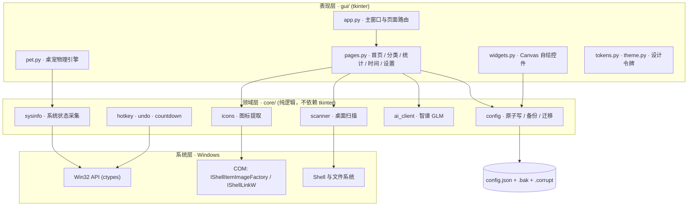

<a id="zh" name="zh"></a>

<div align="center">

# 墨墨桌面管理助手 · MoMo Desktop Manager

**把杂乱的 Windows 桌面，变成一块干净、可归类、有温度的磁贴屏。**
*Turn a cluttered Windows desktop into a clean, categorized, slightly alive tile board.*

[](https://www.python.org/downloads/)
[](LICENSE)
[](#)
[](#技术架构与工程亮点)
[](https://github.com/shi-jin0825/SJ-desktop-manager/releases/tag/v1.13.2)
[](#测试与持续集成)
[](https://github.com/shi-jin0825/SJ-desktop-manager/actions/workflows/tests.yml)
[](#项目结构)

[中文](#zh) · [English](#english)

</div>

---

## 目录

- [项目简介](#项目简介)
- [功能演示](#功能演示)
- [核心功能](#核心功能)
- [技术架构与工程亮点](#技术架构与工程亮点)
- [快速开始](#快速开始)
- [项目结构](#项目结构)
- [测试与持续集成](#测试与持续集成)
- [常见问题](#常见问题)
- [Roadmap](#roadmap)
- [License](#license)
- [English](#english)

---

## 项目简介

Windows 桌面的整理方式，二十年来几乎没有变化：图标只能靠手动拖动、按名称排序，或者干脆堆在屏幕边缘任由它变成"文件垃圾场"。市面上的美化工具大多以替换桌面为目标，一旦卸载便留下一地残留；而真正能"归类但不移动文件"的方案又寥寥无几。

**墨墨桌面管理助手**换了一个思路：它不接管你的桌面，而是把桌面上的文件、文件夹与快捷方式**映射**成一块类似手机桌面的磁贴屏——真实图标、自适应网格、可分类收纳、可全局搜索，底层文件一个都不搬动。

更具辨识度的是，它以 **零第三方运行时依赖** 为技术底线：图形界面用 `tkinter`，系统图标提取、CPU / 内存 / 网速采集、全局热键、快捷方式创建全部通过 `ctypes` 直调 Win32 与 COM 接口实现，连 PNG 编码都是用 `zlib + struct` 手写的。项目迭代至 **v1.13.2，累计 31 个版本，约 10,300 行 Python**，并配有 **62 项自动化测试** 与跨平台 CI。

> 一句话概括：**一个把"少装一个库"当成架构约束，而不是当成偷懒理由的桌面工具。**

---

## 功能演示

<video src="assets/demo.mp4" controls width="100%"></video>

*首页磁贴 → 右键移入分类 → 全局搜索 → 打开分类 → 时间管理 → 番茄钟 → 摸头桌宠 → 数据统计（完整操作链，约 12 秒）*

### 界面截图

| 磁贴桌面（浅色） | 磁贴桌面（深色） |
| :---: | :---: |
|  |  |
| **时间管理：计划 / 倒计时 / 番茄钟** | **数据统计** |
|  |  |

---

## 核心功能

| 模块 | 能力 |
| :--- | :--- |
| **桌面管理** | 自动扫描桌面（含公共桌面）的文件、文件夹、`.lnk` 与 `.url`，过滤隐藏 / 系统项；磁贴每行 4–16 列随窗口宽度自适应；文件夹磁贴内部以 3×3 预览前 9 项图标 |
| **分类体系** | 手机文件夹式分类，右键移入 / 移出；分类只是"映射关系"，**不移动、不重命名、不删除**任何真实文件，卸载即还原 |
| **全局交互** | 侧边栏实时搜索（输入即过滤、回车打开首项）；可自定义全局热键（默认 `Ctrl+Alt+M`）在窗口隐藏时一键呼出；浅色 / 深色主题全界面统一换色并持久化 |
| **桌面宠物「墨墨」** | 独立悬浮窗口，具备抓取甩出、重力下落、撞墙反弹、落地 Q 弹压缩的物理表现；单击摸头开心、连点害羞；CPU 高时冒汗、内存不足时疲惫、网速快时奔跑，并以头顶气泡提示 |
| **时间管理** | 日程计划（可选日期 / 不限日期，按逾期 → 今天 → 未来 → 无日期排序，支持拖拽）、倒数日（每年循环 + 完成度进度条）、番茄钟（重启恢复、离线补签、秒级暂停、多轮休息阶段、声音 + 任务栏闪烁 + 隐藏自动唤起） |
| **AI 助手** | 设置页内嵌对话窗口，接入智谱 `glm-4-flash`；子线程请求、主线程回调；断网、无 Key、限流时全部友好兜底，**不崩溃** |
| **数据统计与管理** | 桌面项目总数、归类覆盖率、类型分布，以及专注轮数、累计时长、计划完成率；配置支持导出 / 导入（校验 + 自动备份）/ 清理 |

---

## 技术架构与工程亮点

### 架构总览



分层原则：**`core/` 不允许 `import tkinter`**。领域逻辑因此可以在无显示环境下被单元测试直接覆盖，GUI 只负责渲染与事件绑定。

### 六个值得关注的工程决策

**1. 零第三方运行时依赖：把约束当成设计语言**

`requirements.txt` 全文只有一行注释。不是"没来得及引入库"，而是主动的取舍：

- **收益**：`git clone` 后 `python main.py` 即可运行；PyInstaller 产物无需捆绑 NumPy / Pillow 等大型轮子，单文件 exe 体积可控；无供应链风险与版本冲突；在离线机器、受限企业环境中可直接部署。
- **代价**：图标解码、PNG 编码、物理动画等能力必须自行实现，开发成本显著高于"装个库"。
- **边界**：PyInstaller 仅作为**构建期**工具，不进入运行时依赖树。

**2. `ctypes` 直调 Win32 / COM，而非封装库**

| 能力 | 实现路径 | 关键细节 |
| :--- | :--- | :--- |
| 真实系统图标 | Shell COM `IShellItemImageFactory::GetImage` → 回退 `SHGetFileInfoW` + `DrawIconEx` → 回退 emoji | 提取 48×48 带 alpha 的真彩位图，能正确解析 Steam / UWP 快捷方式的**目标程序**图标，而非通用箭头 |
| PNG 编码 | `zlib` + `struct` 手写 chunk | 将 HBITMAP 的 BGRA 像素转换为 RGBA 并编码，供 tkinter 直接显示 |
| CPU 占用 | `GetSystemTimes` 两次采样求差 | `kernel` 时间**已包含** `idle`，故占用率为 `(Δkernel + Δuser − Δidle) / (Δkernel + Δuser)`——少减一次 idle 就会得到恒定偏高的错误读数 |
| 网速 | `iphlpapi.GetIfTable2` 64 位计数器差分 | 主动弃用 32 位 `MIB_IFROW`，规避现代 Windows 上的计数器回绕 |
| 全局热键 | `RegisterHotKey` + `WM_HOTKEY` 消息过滤 | 与 Tk 事件循环共存，不劫持主线程消息泵 |
| 快捷方式 | `IShellLinkW` + `IPersistFile` | 零依赖生成带自定义图标的 `.lnk` |

**3. Canvas 逐像素自绘 UI + 设计令牌收敛**

胶囊渐变按钮、圆角输入框、圆角勾选框、线性图标全部由 `Canvas` 绘制，而非原生控件——因为 `ttk` 的可定制上限无法满足视觉稿。

随之而来的问题是数值失控：整理前，**间距在 177 处使用了 18 个不同取值、字号在 93 处使用了 13 个取值**，进度条高度并存 8px / 10px 两套。`gui/tokens.py` 将这一切收敛为两把标尺——页面只声明"语义"（区块间距 / 控件间距 / 标题字号），具体像素由令牌统一裁决。配合 Per-Monitor DPI 感知与等比缩放，界面在 100%–200% 缩放下均保持清晰。

**4. 配置持久化的三层数据保险**

`core/config.py` 的写入路径为：**临时文件 → `flush` + `fsync` → `os.replace` 原子替换**，并在替换前保留上一份健康配置为 `.bak`；读取时若主文件损坏，自动回退 `.bak`，同时把损坏文件隔离为 `config.json.corrupt-<timestamp>` 而不是静默删除。

这解决的是桌面工具最容易被忽视的事故：**在写入途中断电或强杀进程，用户的分类与倒计时会整体归零**。`os.replace` 在 Windows 上同样是原子语义，这一点常被误认为只有 POSIX 才具备。

**5. 「拒绝静默失效」的失败设计**

- **AI 调用**：`core/ai_client.py` 对 401（Key 无效）、429（限流 / 额度耗尽）、5xx、`URLError`、超时逐类映射为可读文案，任何异常都不向上抛出。UI 侧以子线程发请求、主线程回调刷新，输入框在等待期间保持可用。
- **图标提取**：三级回退（COM → Win32 → emoji），保证任何一项都有视觉表示。
- **配置校验**：字段缺失走迁移补全，非法值回落默认，写盘失败给出明确提示而非吞掉异常。
- **撤销**：`core/undo.py` 用**多步撤销栈**替代早期的单变量 `_last_op`。旧实现中"批量移动一批 → 右键再动一项 → 撤销"只会回退最后一步，批量记录凭空消失；改为栈后每一步均可回退，并设深度上限防止无限堆积。

**6. 可测试性是被架构保证的**

`core/` 的纯逻辑（配置原子写、扫描健壮性、AI 客户端错误分支、倒计时计算、撤销栈）全部可在无 GUI 环境下测试；`tests/` 另有 GUI 冒烟测试，在无显示环境下自动跳过而非失败。CI 覆盖 **Windows + Ubuntu × Python 3.10 / 3.11 / 3.12 / 3.13** 共 8 个组合。

### 主张与证据对照

下表把每条关键主张映射到可验证的代码位置，方便按图索骥：

| 主张 | 可验证证据 |
| :--- | :--- |
| 运行时零依赖 | `requirements.txt` 仅含注释；全仓库无第三方 `import` |
| 原子写与损坏恢复 | `core/config.py` → `save()` / `_save_atomic()` / `_load()` / `_quarantine()` |
| 系统图标提取 | `core/icons.py` → COM 优先、Win32 回退、纯标准库 PNG 编码 |
| 系统状态采集 | `core/sysinfo.py` → CPU 差分公式、`GlobalMemoryStatusEx`、`GetIfTable2` |
| 设计规范落地 | `gui/tokens.py` 全量令牌；页面中无裸像素常量 |
| 桌宠物理表现 | `gui/pet.py` 抓取 / 重力 / 反弹 / 落地压缩状态机 |
| 多步撤销 | `core/undo.py` → `UndoStack`，含栈深上限 |
| 测试与 CI | `tests/` 5 个测试文件，62 项用例；`.github/workflows/tests.yml` 矩阵构建 |

---

## 快速开始

### 环境要求

| 项目 | 要求 |
| :--- | :--- |
| 操作系统 | Windows 10 / 11（图标提取、热键、系统采集依赖 Win32；其他平台可启动但功能降级） |
| Python | 3.10+（CI 覆盖至 3.13） |
| tkinter | 随 python.org 官方安装包提供；安装时需勾选 **tcl/tk and IDLE** |
| 第三方库 | **无** |

### 1. 获取代码

```bash
git clone https://github.com/shi-jin0825/SJ-desktop-manager.git
cd SJ-desktop-manager
```

### 2. 安装依赖

本项目无第三方运行时依赖，**无需 `pip install`**。仅需确认 `tkinter` 可用：

```bash
python -c "import tkinter; print('tkinter OK', tkinter.TkVersion)"
```

若报 `ModuleNotFoundError: No module named 'tkinter'`，说明安装 Python 时未勾选 tcl/tk 组件，请重新运行官方安装包并勾选该组件（conda 用户可执行 `conda install tk`）。

`requirements.txt` 保留用于声明"零依赖"这一契约，执行 `pip install -r requirements.txt` 不会安装任何包。

### 3. 配置智谱 API Key

AI 助手能力依赖智谱开放平台的免费模型 `glm-4-flash`。Key 通过环境变量 `ZHIPU_API_KEY` 注入，**源码中不含任何密钥**。

**第一步：获取 Key**

访问 [智谱开放平台](https://open.bigmodel.cn/) → 注册 / 登录 → 右上角「API Keys」→ 创建并复制密钥。

**第二步：写入环境变量**（任选一种）

PowerShell，仅当前窗口有效：

```powershell
$env:ZHIPU_API_KEY = "your_api_key_here"
```

PowerShell / CMD，永久写入当前用户（**推荐**，需新开终端生效）：

```powershell
setx ZHIPU_API_KEY "your_api_key_here"
```

CMD，仅当前窗口有效：

```cmd
set ZHIPU_API_KEY=your_api_key_here
```

**第三步：验证**

```powershell
# PowerShell
$env:ZHIPU_API_KEY

# CMD
echo %ZHIPU_API_KEY%
```

> **注意**：`setx` 只影响此后新启动的进程。若程序已在运行，请关闭并重新启动，或在设置页重开 AI 对话窗口。
>
> **为何不支持 `.env` 文件**：读取 `.env` 需要引入 `python-dotenv`，与"零第三方依赖"的约束冲突。系统环境变量同样是业界标准的密钥注入方式，且在打包后的 exe 中行为一致。未配置 Key 时，除 AI 对话外的所有功能均可正常使用。

### 4. 运行

```bash
python main.py
```

或直接双击项目根目录的 `run.bat`——它会按「`MOMO_PYTHON` → `py -3` → PATH → 常见安装目录 → 便携运行时」的顺序自动探测可用的 Python，无需手动配置路径。

启动后：

- 首次运行会自动扫描桌面并生成磁贴，`config.json` 在首次保存时创建；
- 默认全局热键 `Ctrl+Alt+M` 呼出 / 隐藏窗口，可在「设置 → 全局热键」中修改；
- 右键磁贴可移入分类，侧边栏顶部搜索框支持即时过滤。

### 5. 运行测试

```bash
python -m unittest discover -s tests -v
```

预期输出 `Ran 62 tests ... OK`。GUI 冒烟测试在无显示环境下会自动跳过（`skipped`），不影响结果。

### 6. 打包为单文件 exe

```bash
python tools/build_exe.py
```

产物位于 `dist/墨墨桌面管理助手.exe`，可在未安装 Python 的 Windows 机器上直接运行。构建依赖 PyInstaller，但**产物运行时不依赖任何第三方库**。

---

## 项目结构

```text
SJ-desktop-manager/
├── main.py                  # 入口：DPI 感知 → 启动 App
├── run.bat                  # 免配置启动器（自动探测 Python）
├── requirements.txt         # 声明零第三方依赖
│
├── core/                    # 领域层：纯逻辑，禁止 import tkinter
│   ├── config.py            #   配置原子写 / 备份 / 损坏隔离 / 迁移
│   ├── scanner.py           #   桌面扫描（含公共桌面、隐藏项过滤）
│   ├── icons.py             #   系统图标提取 + 纯标准库 PNG 编码
│   ├── sysinfo.py           #   CPU / 内存 / 网速采集
│   ├── ai_client.py         #   智谱 GLM 客户端（含全错误分支兜底）
│   ├── hotkey.py            #   全局热键注册与消息过滤
│   ├── countdown.py         #   倒数日 / 番茄钟时间计算
│   ├── undo.py              #   多步撤销栈
│   └── dpi.py               #   Per-Monitor DPI 感知
│
├── gui/                     # 表现层：tkinter
│   ├── app.py               #   主窗口、侧边栏、页面路由、全局搜索
│   ├── pages.py             #   首页 / 分类 / 统计 / 时间管理 / 设置
│   ├── widgets.py           #   Canvas 自绘控件（胶囊按钮 / 圆角框 / 勾选框）
│   ├── pet.py               #   桌宠「墨墨」物理引擎与状态联动
│   ├── theme.py             #   浅色 / 深色主题
│   ├── tokens.py            #   设计令牌（间距 / 字号 / 控件尺寸）
│   ├── fonts.py             #   字体与 DPI 缩放
│   ├── navicons.py          #   侧边栏线性图标
│   └── category_ops.py      #   分类交互编排
│
├── tests/                   # 62 项自动化测试
│   ├── test_core.py         #   配置 / 扫描 / 倒计时 / 撤销
│   ├── test_ai_client.py    #   AI 客户端错误分支（含 Mock 网络）
│   ├── test_gui.py          #   GUI 冒烟
│   ├── test_pages_smoke.py  #   页面实例化冒烟
│   └── test_design.py       #   设计令牌一致性
│
├── tools/                   # 构建与素材生成脚本（不进入运行时）
│   ├── build_exe.py         #   PyInstaller 单文件打包
│   ├── make_icon.py         #   .ico 生成
│   ├── make_shortcut.py     #   .lnk 生成
│   ├── momo_faces.py        #   7 种表情程序化绘制
│   └── mascot_cutout.py     #   立绘抠图
│
├── assets/                  # 界面截图、图标、桌宠立绘
└── .github/workflows/       # CI：2 OS × 4 Python 版本
```

---

## 测试与持续集成

```text
Ran 62 tests in 0.46s
OK (skipped=12)
```

- **覆盖范围**：`core/` 纯逻辑（配置原子写、损坏恢复、扫描健壮性、倒计时与番茄钟状态机、撤销栈）、`ai_client` 的全部错误分支（401 / 429 / 5xx / 超时 / 无 Key，均以 Mock 注入）、GUI 与页面实例化冒烟、设计令牌一致性。
- **CI 矩阵**：`ubuntu-latest` + `windows-latest` × Python `3.10 / 3.11 / 3.12 / 3.13`，共 8 个组合，任一失败即红。
- **跳过策略**：无显示环境下的 GUI 用例自动 `skip` 而非 `fail`，避免 CI 噪声掩盖真实回归。

```bash
# 全量测试
python -m unittest discover -s tests -v

# 仅核心逻辑
python -m unittest tests.test_core -v
```

---

## 常见问题

<details>
<summary><b>启动时报 <code>No module named 'tkinter'</code></b></summary>

Python 安装时未包含 tcl/tk 组件。Windows 请重新运行 [python.org](https://www.python.org/downloads/) 安装包并勾选 **tcl/tk and IDLE**；conda 环境执行 `conda install tk`。
</details>

<details>
<summary><b>AI 对话提示「还没拿到 API Key」</b></summary>

环境变量未生效。确认变量名为 `ZHIPU_API_KEY`（全大写），并使用 `setx` 写入后**新开终端**；程序启动后才设置的变量对当前进程不可见，需重启程序。
</details>

<details>
<summary><b>AI 提示「Key 好像不对」或「额度用完了」</b></summary>

分别对应 HTTP 401 与 429。前者请检查 Key 是否复制完整、是否已在智谱平台启用；后者为免费额度耗尽或瞬时限流，稍后重试即可。这两类错误均不会导致程序崩溃。
</details>

<details>
<summary><b>磁贴里出现通用箭头图标</b></summary>

说明该快捷方式的目标已失效（程序被卸载或路径变更），三级图标回退机制退到了默认图标。删除该快捷方式即可。
</details>

<details>
<summary><b>能否在 macOS / Linux 上运行？</b></summary>

可以启动，但系统图标提取、全局热键、CPU / 内存 / 网速采集均为 Win32 实现，会降级为 emoji 图标并关闭对应功能。本项目定位是 Windows 桌面工具。
</details>

<details>
<summary><b>分类操作会移动或删除我的桌面文件吗？</b></summary>

不会。分类仅记录"路径 → 分类名"的映射关系，存于 `config.json`；移出分类只是删除该映射。所有文件操作均不涉及移动、重命名或删除。
</details>

---

## Roadmap

- [ ] 桌面项多选与批量拖拽分类
- [ ] 分类自定义图标与排序
- [ ] 番茄钟与系统勿扰模式（Focus Assist）联动
- [ ] 可选的多 Provider 适配层（保持 OpenAI 兼容协议，默认仍为智谱）

---

## 更新日志

### v1.13.2 — 设置页「AI 助手」对话窗口

- 设置页新增「AI 助手」区块 +「打开对话」按钮，弹出独立对话窗口；聊天气泡、输入框、发送按钮与主界面同一套配色 / 控件风格，支持回车发送，请求走子线程不卡界面，断网 / 无 Key 友好兜底。

### v1.13.1 — 接入智谱 GLM 大模型（AI 对话）

- 新增 `core/ai_client.py` 独立封装 `ask_ai`（默认 `glm-4-flash`）；`gui/app.py` 新增 `App.ask_momo` 子线程发请求 + 主线程回调；全链路异常兜底（未配 Key / 断网 / Key 无效 / 余额不足均不崩溃）；Key 走环境变量 `ZHIPU_API_KEY`。

### v1.13.0 — 番茄钟 2.0：持久化 / 暂停恢复 / 休息阶段 + 数据闭环

- 计时状态落盘、重启恢复、退出期间到点自动补签；秒级暂停 / 继续 + 顶栏常驻倒计时；专注 → 休息 → 下一轮多循环打通；到点提示音 + 任务栏闪烁 + 自动唤起；桌宠召唤持久化、气泡优先级仲裁；统计页新增「专注与计划」、设置页新增「数据管理」（导出 / 导入 / 清理）。

> 完整版本历史见 [CHANGELOG.md](CHANGELOG.md)。

## License

本项目基于 [MIT License](LICENSE) 开源，Copyright © 2026 [shi-jin0825](https://github.com/shi-jin0825)。

---

<a id="english"></a>

# English

<div align="center">

**MoMo Desktop Manager** — a Windows desktop organizer that maps your cluttered desktop into a clean, phone-style tile board.

[](https://www.python.org/downloads/)
[](LICENSE)
[](#engineering-highlights)
[](#testing--ci)

</div>

## Overview

For two decades, organizing a Windows desktop has meant one of two things: dragging icons around by hand, or giving up entirely. Most "desktop beautification" tools replace the shell, leave registry residue behind, and break on uninstall.

MoMo takes a different route. It does not take over your desktop — it **maps** the files, folders and shortcuts already there into an adaptive, icon-accurate tile board with folders, categories and instant search. **No file is ever moved, renamed or deleted.**

Under the hood, the project holds a deliberately strict constraint: **zero third-party runtime dependencies.** The UI is built with `tkinter`; system icon extraction, CPU / memory / network sampling, global hotkeys and shortcut creation all go through `ctypes` into Win32 and COM directly. Even PNG encoding is hand-written on top of `zlib` and `struct`. The result is **v1.13.2 across 31 releases, ~10,300 lines of Python, 62 automated tests**, and a cross-platform CI matrix.

> In one sentence: a desktop tool that treats *"one less dependency"* as an architectural constraint rather than an excuse.

## Demo

<video src="assets/demo.mp4" controls width="100%"></video>

*Tile board → right-click categorize → global search → open category → time management → pomodoro → pat the pet → stats (full flow, ~12s)*

| Tile board (light) | Tile board (dark) |
| :---: | :---: |
|  |  |
| **Time management** | **Statistics** |
|  |  |

## Features

- **Desktop mapping** — scans desktop and public desktop for files, folders, `.lnk` and `.url`, filtering hidden/system entries. Tiles reflow from 4 to 16 columns; folder tiles preview the first 9 child icons in a 3×3 grid.
- **Categories without side effects** — phone-style folders backed by a path→category map in `config.json`. Right-click to file items in or out; nothing on disk changes.
- **Global access** — type-to-filter search in the sidebar, Enter opens the first hit; a customizable global hotkey (default `Ctrl+Alt+M`) summons the window when hidden; full light/dark theming, persisted.
- **Desktop pet "MoMo"** — a separate always-on-top window with a small physics model: grab-and-throw, gravity, wall bounce, landing squash. Click to pet, rapid-click to make it shy. It sweats when CPU is high, looks tired when memory is low, and sprints when the network is fast.
- **Time management** — dated and undated tasks with drag-to-reorder, recurring countdowns with progress bars, and a pomodoro timer that survives restarts, supports second-accurate pause/resume, multi-round breaks, and sound + taskbar-flash + auto-summon alerts.
- **AI assistant** — an in-app chat panel backed by Zhipu `glm-4-flash`. Requests run on a worker thread with a main-thread callback; every failure mode (offline, missing key, rate limit) degrades to a readable message instead of an exception.

## Engineering Highlights

**1. Zero runtime dependencies as a design language.** `requirements.txt` contains a single comment line — not an oversight, a trade-off. Clone and run; single-file executables stay small; no supply-chain surface and no version conflicts. The cost is real: icon decoding, PNG encoding and animation physics had to be implemented from scratch. PyInstaller is a *build-time* tool only and never enters the runtime tree.

**2. `ctypes` into Win32 / COM instead of wrapper libraries.**

| Capability | Implementation | Detail that matters |
| :--- | :--- | :--- |
| Real system icons | Shell COM `IShellItemImageFactory::GetImage`, fallback `SHGetFileInfoW` + `DrawIconEx`, then emoji | Resolves the *target* icon of Steam / UWP shortcuts rather than a generic arrow; 48×48 with alpha |
| PNG encoding | `zlib` + `struct`, hand-written chunks | Converts BGRA bitmaps to RGBA for direct display in tkinter |
| CPU usage | `GetSystemTimes` sampled twice | `kernel` time already includes `idle`, so usage is `(Δkernel + Δuser − Δidle) / (Δkernel + Δuser)` |
| Network throughput | `iphlpapi.GetIfTable2` 64-bit counters | Deliberately avoids 32-bit `MIB_IFROW` wraparound on modern Windows |
| Global hotkey | `RegisterHotKey` + `WM_HOTKEY` filtering | Coexists with Tk's event loop without hijacking the message pump |

**3. Canvas-drawn UI, governed by design tokens.** Pill-shaped gradient buttons, rounded inputs and checkboxes are painted on `Canvas` because `ttk` cannot be themed that far. The predictable failure mode followed: spacing had drifted to **18 distinct values across 177 call sites**, type sizes to **13 values across 93 sites**. `gui/tokens.py` collapsed this into two scales — pages declare intent, tokens decide pixels — alongside per-monitor DPI awareness.

**4. Three layers of data protection.** Every write goes *temp file → `flush` + `fsync` → `os.replace`*, keeping the previous healthy file as `.bak`. On read, a corrupt primary silently recovers from `.bak` and quarantines the damaged file as `config.json.corrupt-<timestamp>` instead of deleting it. This addresses the failure users never forgive: losing every category and countdown because the process died mid-write. (`os.replace` is atomic on Windows too — a widely held misconception.)

**5. Failure paths that refuse to fail silently.** `core/ai_client.py` maps 401, 429, 5xx, `URLError` and timeouts to human-readable messages and never re-raises. Icon extraction degrades through three tiers so every item stays visible. Config validation migrates missing fields and rejects invalid ones. `core/undo.py` replaced a single `_last_op` variable with a bounded multi-step stack — the old code lost batch operations whenever a right-click followed them.

**6. Testability enforced by architecture.** `core/` never imports `tkinter`, so domain logic runs under plain `unittest` in headless environments; GUI smoke tests skip rather than fail when no display is available. CI covers Windows and Ubuntu across Python 3.10–3.13.

## Quick Start

**Requirements:** Windows 10/11 · Python 3.10+ with `tkinter` (tick *tcl/tk and IDLE* in the official installer) · **no third-party packages**.

**Step 1 — clone and verify the toolchain**

```bash
git clone https://github.com/shi-jin0825/SJ-desktop-manager.git
cd SJ-desktop-manager

# Nothing to pip install; just confirm tkinter ships with your interpreter
python -c "import tkinter; print('tkinter OK', tkinter.TkVersion)"
```

**Step 2 — provide the Zhipu API key** (PowerShell)

```powershell
# Persist for the current user, then open a new terminal
setx ZHIPU_API_KEY "your_api_key_here"

# ...or export for this session only
$env:ZHIPU_API_KEY = "your_api_key_here"
```

**Step 3 — run**

```bash
python main.py          # or double-click run.bat
```

The key is read from `ZHIPU_API_KEY` at request time and never appears in source. Get one at [open.bigmodel.cn](https://open.bigmodel.cn/) → *API Keys*. A `.env` file is intentionally unsupported, since parsing it would require `python-dotenv` and violate the zero-dependency constraint; OS-level environment variables behave identically inside the packaged `.exe`. Without a key, every feature except AI chat still works.

```bash
# Run the test suite (expect: Ran 62 tests ... OK)
python -m unittest discover -s tests -v

# Build a standalone single-file executable -> dist/
python tools/build_exe.py
```

The app auto-scans the desktop on first launch. Default hotkey is `Ctrl+Alt+M`; right-click any tile to file it into a category; the sidebar search filters as you type.

## Project Structure

```text
main.py              entry point (DPI awareness -> App)
run.bat              launcher with automatic Python discovery
core/                domain layer, tkinter-free and unit-testable
  config.py          atomic writes, backup, corruption quarantine, migration
  scanner.py         desktop scanning, hidden/system filtering
  icons.py           COM/Win32 icon extraction + stdlib PNG encoder
  sysinfo.py         CPU / memory / network sampling
  ai_client.py       Zhipu GLM client with exhaustive error handling
  hotkey.py undo.py countdown.py dpi.py
gui/                 presentation layer (tkinter)
  app.py pages.py widgets.py pet.py theme.py tokens.py fonts.py navicons.py
tests/               62 tests: core logic, AI error branches, GUI smoke, tokens
tools/               build and asset-generation scripts (not shipped)
assets/              screenshots, icons, pet sprites
.github/workflows/   CI: 2 operating systems x 4 Python versions
```

## Testing & CI

`Ran 62 tests in 0.46s — OK (skipped=12)`

Coverage spans atomic config writes and corruption recovery, scanner robustness, countdown and pomodoro state machines, the undo stack, every `ai_client` error branch (401/429/5xx/timeout/missing key via mocks), plus GUI instantiation smoke tests and design-token consistency. The GitHub Actions matrix runs Ubuntu and Windows against Python 3.10–3.13 — eight combinations, any failure turns the build red. Headless GUI cases are skipped, not failed, so CI noise never hides a real regression.

## FAQ

- **`No module named 'tkinter'`** — reinstall Python with the *tcl/tk and IDLE* component, or run `conda install tk`.
- **"Key not found"** — the variable must be `ZHIPU_API_KEY`; after `setx`, open a new terminal and restart the app.
- **HTTP 401 / 429** — invalid key / exhausted free quota. Both degrade gracefully; the app will not crash.
- **Generic arrow icons** — the shortcut's target no longer exists, so extraction fell back to the default icon.
- **Does categorizing move my files?** — No. Categories are a path→name map in `config.json`. Nothing is moved, renamed or deleted.

## License

[MIT](LICENSE) © 2026 [shi-jin0825](https://github.com/shi-jin0825)

---

<div align="center">

**如果这个项目对你有帮助，欢迎点一个 ⭐ Star。**
*If this project helps you, a ⭐ star is appreciated.*

</div>
